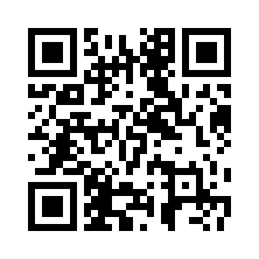

# أداة استخراج أرقام بايو تيك توك (بحث عميق)

[English](README.md) · **العربية**

أداة تعتمد على الـ **API الخالص** (بدون متصفح وبدون سلينيوم) تزحف في تيك توك
بعمق لاكتشاف الحسابات واستخراج **أرقام الهاتف من البايو**، ثم تخمّن **دولة** كل
رقم مع توزيع احتمالات.

تعمل عبر توقيع طلبات واجهة الويب يدويًا، واستخدام
[`curl_cffi`](https://github.com/lexiforest/curl_cffi) مع تقليد بصمة متصفح
لتجاوز فحص TLS الخاص بـ Akamai.

> **تنويه:** هذا المشروع لأغراض تعليمية وبحثية فقط. أنت مسؤول عن الالتزام بشروط
> استخدام تيك توك وبقوانين الخصوصية وحماية البيانات المعمول بها. لا تستخدمه
> لجمع البيانات الشخصية أو إساءة استخدامها.

---

## المزايا

- **API خالص** — لا أتمتة متصفح؛ طلبات HTTP موقّعة مباشرة.
- **زحف عميق ومستمر** — توسّع BFS في شجرة المتابعين: حساب ← متابعوه ← متابعو
  متابعيه ← … حتى عمق قابل للضبط. يتضخّم الطابور تلقائيًا فيستمر البحث ويتعمّق.
- **بذور بالكلمات/الهاشتاقات** — اكتشاف حسابات عبر كلمات البحث.
- **استخراج الأرقام** — يدعم الأرقام العربية/الفارسية واللاتينية وروابط واتساب
  والفواصل الشائعة.
- **تخمين الدولة باحتمالات** — خوارزمية هجينة تعتمد على بنية الرقم وإشارات
  البايو (الأعلام، أسماء المدن/الدول، المفاتيح الدولية).
- **تصنيف نوع النشاط تلقائيًا** — يُصنَّف كل حساب (عقارات، سيارات، مطاعم، توصيل،
  تسويق، طبي، …) من بايوه عبر خوارزمية كلمات مرجّحة، تُحسب تلقائيًا لحظة جمع
  الأرقام.
- **حالة دائمة** — تُسجَّل الحسابات المسحوبة سابقًا وتُتخطّى في التشغيلات
  اللاحقة (لا إعادة سحب).
- **مخرجات JSON تدريجية ومنزوعة التكرار.**

---

## آلية العمل

تُوقّع الطلبات في جهة العميل كما يفعل `webmssdk` في تيك توك:

| التوقيع       | المصدر                                             |
| ------------- | -------------------------------------------------- |
| `X-Gnarly`    | يُحسب في `gnarly.py` (قائم على ChaCha)             |
| `X-Bogus`     | `1` (قيمة ثابتة تكفي)                               |
| `msToken`     | نص عشوائي بطول 128                                  |
| `X-Dynosaur`  | توكِن قابل لإعادة الاستخدام يُلتقط من المتصفح ويُخزَّن في `config.json` (للبحث فقط) |

نقاط النهاية المستخدمة:

- بحث المستخدم: `/api/search/user/full/` (يحتاج `X-Dynosaur`)
- قائمة المتابعين: `/api/user/list/?scene=67` (لا يحتاج `X-Dynosaur`)

طلبات `requests` العادية تُحجب (رد فارغ) بسبب بصمة TLS/JA3، و`curl_cffi` مع
`impersonate` يحلّ ذلك.

---

## التثبيت

```bash
python3 -m venv .venv
source .venv/bin/activate
pip install -r requirements.txt
```

## الإعداد

انسخ ملف الإعداد النموذجي واملأ قيمك:

```bash
cp config.example.json config.json
```

حرّر `config.json`:

- **`cookie`** — سلسلة كوكيز كاملة لحساب مسجّل الدخول من متصفحك، ويجب أن تحتوي
  على `sessionid=...` (قائمة المتابعين تتطلب تسجيل الدخول).
- **`x_dynosaur`** — توكِن يُلتقط من طلب بحث في تبويب الشبكة بالمتصفح، وهو قابل
  لإعادة الاستخدام؛ جدّده إذا بدأ البحث يرجع ردودًا فارغة.
- **`impersonate`** — بصمة المتصفح في `curl_cffi` (الافتراضي `firefox133`).
- إعدادات أخرى: `max_followers_per_user`, `max_depth`, `max_users`,
  `delay_min`/`delay_max`, `keywords`, `output`, `state`.

> ملف `config.json` مُستثنى من Git كي لا تُرفَع الكوكيز/التوكِنات الحقيقية.

### كيفية التقاط `cookie` و`x_dynosaur`

1. سجّل الدخول إلى `tiktok.com` في متصفحك.
2. افتح أدوات المطور → Network، ثم نفّذ **بحثًا عن مستخدم**.
3. افتح طلب `/api/search/user/full/`:
   - انسخ ترويسة `Cookie` كاملة → `cookie`.
   - انسخ معامل `X-Dynosaur` من الرابط → `x_dynosaur`.

---

## الاستخدام

### 1) فحص متابعي حساب واحد (`search_bio.py`)

```bash
python3 search_bio.py coderoot.ksa
python3 search_bio.py user1 user2 --max-followers 1000
python3 search_bio.py someuser --no-seed
```

### 2) الزاحف العميق المستمر (`deep_search.py`)

```bash
# من كلمات/هاشتاقات
python3 deep_search.py --keywords "مطعم" "عقارات" "توصيل" --max-depth 6

# من حسابات بذرة
python3 deep_search.py --seeds coderoot.ksa --max-depth 6 --max-followers 800

# حدود أوسع
python3 deep_search.py --keywords "متجر" --max-users 200000 --max-depth 6
```

| الخيار             | الوصف                                          | الافتراضي          |
| ------------------ | ---------------------------------------------- | ------------------ |
| `--keywords`       | كلمات بحث/هاشتاقات للبدء                        | من الإعداد         |
| `--seeds`          | حسابات بذرة للبدء                              | —                  |
| `--max-depth`      | عمق التوسّع في شجرة المتابعين                   | 4                  |
| `--max-followers`  | أقصى متابعين لكل حساب                          | 1000               |
| `--max-users`      | أقصى حسابات تُعالَج (حدّ أمان)                  | 1000000            |
| `--state`          | ملف حالة الحسابات المسحوبة سابقًا               | `output/crawl_state.json` |
| `--reset-state`    | تجاهل الحالة والبدء من الصفر                    | معطّل              |
| `--delay-min/max`  | تأخير عشوائي بين الطلبات (ثوانٍ)                | 0.3 / 1.0          |

- يعمل **باستمرار** ويتعمّق ما دام الطابور غير فارغ.
- أوقفه في أي لحظة بـ **Ctrl+C**؛ يُحفَظ التقدّم والحالة.
- الحسابات الخاصة لا تُتوسّع (قائمة متابعيها غير متاحة).

### 3) إثراء ملف موجود (`enrich_country.py`, `enrich_categories.py`)

```bash
python3 enrich_country.py                  # إضافة/تحديث معلومات الدولة
python3 enrich_categories.py               # إضافة/تحديث تصنيف نوع النشاط
python3 enrich_country.py path/to/file.json
```

---

## صيغة المخرجات

تُحفَظ النتائج في `output/tiktok-bio.json` (مصفوفة JSON منزوعة التكرار):

```json
{
  "name": "مطعم موازين دبي",
  "username": "bouchtadubai",
  "phone": "0547166686",
  "country": "United Arab Emirates",
  "country_ar": "الإمارات",
  "country_iso": "AE",
  "dial_code": "+971",
  "country_confidence": 0.636,
  "country_probs": { "AE": 0.636, "SA": 0.364 },
  "category": "Restaurants & Food",
  "category_ar": "مطاعم وأطعمة",
  "category_confidence": 1.0,
  "category_tags": ["restaurant"],
  "bio": "... ديرة دبي ...",
  "source": "search:مطعم"
}
```

قيمة `source` تكون إحدى: `search:<كلمة>` أو `seed:@<مستخدم>` أو
`follower_of:@<مستخدم>`.

---

## خوارزمية تخمين الدولة

1. **مفتاح دولي صريح** (`+` / `00` / مفتاح معروف في البداية) ← ثقة عالية.
2. **الصيغة المحلية** — بادئات الجوّال الوطنية:
   - `01[0125]` (11 رقمًا) ← مصر.
   - `05x` (10 أرقام) ← السعودية/الإمارات حسب البادئة
     (`053/057/059` = سعودية، `052` = إماراتية، `050/054/055/056/058` = مشتركة).
   - `920 / 800` ← أرقام موحّدة سعودية.
   - 8 أرقام بلا صفر بادئ ← ترقيم خليجي ثماني.
3. **إشارات البايو** — أعلام الدول (🇸🇦🇦🇪🇪🇬…) وأسماء المدن/الدول والمفاتيح
   الدولية المذكورة نصًّا تُرجّح المرشّح المطابق.

تُطبَّع الدرجات إلى توزيع احتمالات (`country_probs`) مفتاحه رمز ISO، ويصبح
المرشّح الأعلى هو `country`/`country_confidence`.

## تصنيف نوع النشاط

يُصنَّف كل حساب ضمن ~17 فئة (عقارات، سيارات، توصيل، تسويق، مطاعم، ملابس، تجميل،
طبي، تعليم، تنظيف، أثاث، مقاولات، طباعة، تقنية، مالية، سياحة، متجر) عبر قوائم
كلمات مرجّحة على البايو والاسم. تُطبَّع الدرجات إلى توزيع احتمالات، فيصبح الأعلى
هو `category`/`category_ar` مع `category_confidence`، وتُدرَج أعلى 3 مفاتيح في
`category_tags`. الحسابات بلا إشارة نشاط واضحة تُترَك بلا تصنيف (`null`) بدل
إجبارها.

---

## بنية المشروع

```
.
├── search_bio.py         # فحص متابعي حساب واحد (API خالص)
├── deep_search.py        # الزاحف العميق المستمر (BFS)
├── country.py            # خوارزمية: رقم -> احتمالات الدولة
├── categories.py         # تصنيف نوع النشاط من البايو
├── phones.py             # استخراج أرقام الهاتف من البايو
├── enrich_country.py     # إضافة معلومات الدولة لملف نتائج موجود
├── enrich_categories.py  # إضافة تصنيف النشاط لملف نتائج موجود
├── gnarly.py             # مولّد توقيع X-Gnarly
├── config.example.json   # قالب الإعداد (انسخه إلى config.json)
├── requirements.txt
└── output/               # النتائج والحالة (مُستثنى من Git)
```

---

## عن شركة Storage TE

طُوِّر هذا المشروع وتصونه شركة **[Storage TE](https://storage-te.com/)** — شركة
برمجيات متخصّصة في **الهندسة العكسية** والأتمتة وأدوات النمو والبرمجة المخصّصة
والذكاء الاصطناعي. نبني مواقع وتطبيقات، ولوحات تحكم، وأنظمة استخراج البيانات
وتوليد العملاء المحتملين (مثل ليدز Google Maps والسوشيال)، وأبحاث التواقيع
ومكافحة البوتات، ومنصّات النمو الرقمي للسوشيال ميديا.

اعرف المزيد على **[storage-te.com](https://storage-te.com/)**.

## الصيانة والشركة والتواصل 👤

| | |
| --------- | ---------------------------------------- |
| المطوّر  | Mostafa Al-Bagouri (مصطفى الباجوري)      |
| الشركة   | [Storage TE](https://storage-te.com/)    |
| واتساب   | ‎+20 100 199 5914                        |
| البريد   | info@storage-te.com                      |

## ادعم المشروع ☕

إذا كانت هذه الأدوات مفيدة لك، فالدعم اختياري ويساعد على صيانتها وتحسينها
وتطوير الأعمال المرتبطة بها. اختر ما يناسبك.

| القناة | طريقة الدعم |
| ------ | ----------- |
| PayPal | [paypal.me/sofaapi](https://paypal.me/sofaapi) |
| Binance Pay / UID | `1138751298` — أرسِل من تطبيق Binance (Pay / تحويل داخلي عند توفّره). |
| Binance — إيداع (ويب) | أودِع عملة رقمية (Binance) — سجّل الدخول، اختر الأصل، ثم اختر **BSC (BEP20)**. |
| عنوان BSC (انسخه) | `0x94c5005229784d9b7df4e7a7a0c3b25a08fd57bc` |

> **الشبكة:** استخدم **BSC (BEP-20) فقط**. هذا العنوان لـ **USDT (BEP-20)** و**BTC
> على BSC** (Binance-Peg / «BTC» داخل تطبيق Binance على BSC)، بما يطابق مسار
> الإيداع في Binance. **لا** ترسل بيتكوين الأصلي (on-chain BTC)، ولا ERC-20، ولا
> NFTs إلى هذا العنوان.

### رموز QR للإيداع (امسحها في Binance أو أي محفظة BSC)

| USDT · BSC | BTC · BSC |
| :--------: | :-------: |
|  |  |

كلا الرمزين يشفّران عنوان BSC (BEP-20) نفسه أعلاه.

---

## الكلمات المفتاحية (Keywords)

`tiktok` · `tiktok-api` · `tiktok-scraper` · `web-scraping` · `crawler` ·
`osint` · `lead-generation` · `phone-numbers` · `data-extraction` ·
`reverse-engineering` · `x-gnarly` · `x-bogus` · `msToken` · `curl-cffi` ·
`tls-fingerprinting` · `country-detection` · `business-classification` ·
`followers` · `bio-scraper` · `arabic` · `python` · `automation` · `storage-te`

تيك توك · سكرابر · استخراج أرقام · توليد عملاء · هندسة عكسية · زاحف ·
كشف الدولة · تصنيف النشاط · متابعين · بايو · بايثون · أتمتة · Storage TE

---

## إخلاء مسؤولية

لأغراض البحث والتعليم فقط؛ التزم بشروط استخدام تيك توك وبالقوانين المعمول بها.

## الرخصة

[MIT](LICENSE)
