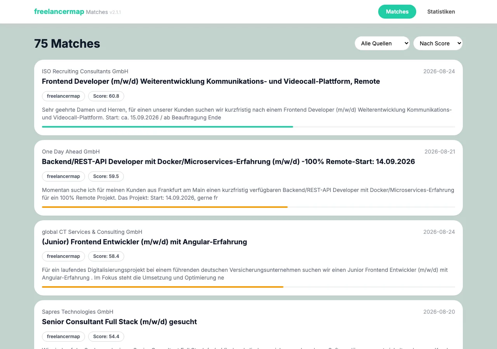
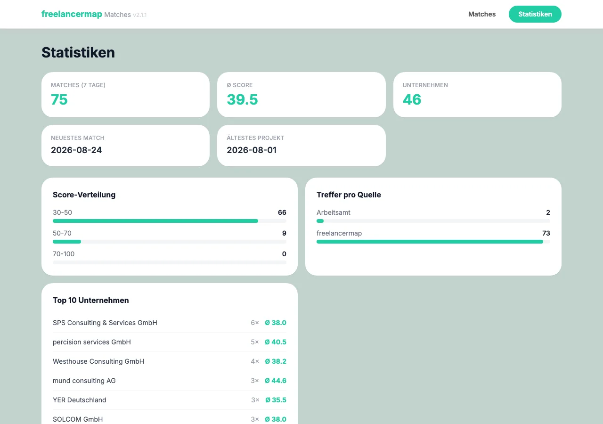

# Freelancer Matches `v2.1.1`

Scrapes projects from [freelancermap.de](https://www.freelancermap.de) and self-employment listings from the German Federal Employment Agency (Bundesagentur für Arbeit), matches them against your skill profile, and shows the results in a web interface.

## Screenshots




---

## Features

- Two sources: freelancermap.de (AJAX API) and Bundesagentur für Arbeit Jobsuche (self-employment), each can be toggled independently
- Matching against a configurable skill profile with a score (0–100)
- **SQLModel ORM** for type-safe database access
- SQLite database storing all projects and matches, tagged by source
- Web interface (Flask) with matches, detail view, and statistics — filterable and sortable by source, sortable by score or date
- CSV export of matches

## Scoring

| Category                                      | Max. points |
| ---------------------------------------------- | ----------- |
| Keyword matches (exact)                        | 30          |
| Keyword matches (partial)                      | 20          |
| Skills in description                          | 20          |
| Preferred keywords in description              | 10          |
| Recency (exponential decay, 15 days)           | 20          |

Projects containing excluded keywords automatically get a score of 0.

> Arbeitsamt hits have no structured keywords, only a description — the keyword score doesn't apply to them (max. 50 instead of 100 points possible).

---

## Installation

### Requirements

- Python 3.13+
- [uv](https://docs.astral.sh/uv/getting-started/) – fast Python package manager

### Setup

```bash
# Clone the repository
git clone ...
cd freelancermap

# Install dependencies & initialize the virtual environment
uv sync
```

### Credentials

Create a `.env` file in the project folder (only needed for the freelancermap source; the Arbeitsamt API needs no login):

```env
FREELANCERMAP_USERNAME=your@email.com
FREELANCERMAP_PASSWORD=yourPassword
```

### Configuration

`config.py` is git-ignored (personal profile, not meant to be pushed/pulled).
Create it from the template once and adjust it:

```bash
cp config.example.py config.py
```

---

## Usage

### Scraper (terminal)

```bash
uv run python projectMatcher.py
```

Runs inside the venv created by `uv sync` — no manual activation needed. Credentials come from `.env`, all other settings from `config.py`.

### Web interface

```bash
uv run python webserver.py
# → http://localhost:5050
```

Filter and sort the matches list via query params or the dropdowns on the page: `?source=freelancermap|arbeitsamt` to filter by source, `?sort=score|date` to sort (default: score). `/statistics` also breaks matches down by source.

### Database browser

```bash
uv run python -m sqlite_web freelancermap.db
# → http://localhost:8080
```

---

## Configuration (`config.py`)

```python
# Which sources to scrape: "freelancermap", "arbeitsamt"
SOURCES = ["freelancermap", "arbeitsamt"]

MAX_PAGES = 10  # freelancermap: how many result pages per run
MIN_SCORE = 30  # matches below this score are discarded, not saved

PROFILE = {
    "skills": ["Python", "JavaScript", "React", "Vue", "AWS", ...],
    "preferred_keywords": ["Backend", "Frontend", "Fullstack", ...],
    "excluded_keywords": ["SAP", "Drupal"],
}
```

- **`SOURCES`**: remove a source to skip it on the next run (e.g. just `["freelancermap"]` if the Arbeitsamt yield is too thin).
- **`MAX_PAGES`** only applies to freelancermap; the Arbeitsamt source queries once per profile skill.
- **`MIN_SCORE`** applies to both sources and to the CSV export.
- **`PROFILE`** drives the matching: `skills` = your competencies, `preferred_keywords` = bonus points, `excluded_keywords` = hard exclusion (score 0).

---

## Project structure

```
freelancermap/
├── projectMatcher.py   # freelancermap scraper, matching logic, entry point (main)
├── arbeitsamt.py         # Arbeitsamt Jobsuche scraper (source "arbeitsamt")
├── webserver.py            # Flask web interface
├── models.py                 # SQLModel ORM definitions
├── database.py                # Database connection & initialization
├── version.py                  # Reads the version from pyproject.toml
├── templates/                    # HTML templates (Tailwind)
├── docs/                            # Screenshots
├── config.example.py                 # Profile template (in git)
├── config.py                            # your profile (git-ignored, see above)
├── pyproject.toml                          # Dependencies (uv)
├── uv.lock                                    # Lock file for reproducible installs
└── .env                                          # Credentials (not in git)
```

---

## License

MIT
