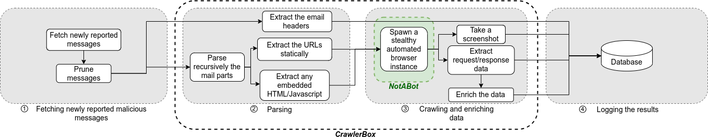

# CrawlerBox
## Description
*CrawlerBox* is an automated analysis framework designed for parsing emails and crawling embedded web resources. This infrastructure was developed to facilitate the study of evasive phishing emails reported by end users.

For more detailed information on *CrawlerBox*, its functionality, and the results obtained, please refer to our paper "A Closer Look at Modern Evasive Phishing Emails".
<figure>
    
    <figcaption>Figure 1: CrawlerBox Analysis Pipeline</figcaption>
</figure>


## Getting started

### Installation 
CrawlerBox is meant to be run on Windows. 


#### Local installation
Local installation can be done using uv
```bash
git clone https://github.com/AmadeusITGroup/CrawlerBox.git
cd CrawlerBox
uv venv -p python3.10
uv pip install -e .
.venv\Scripts\activate.bat 

```


#### Necessary dependencies and configuration
First you need to install [vcredist_x64.exe](https://www.microsoft.com/en-gb/download/details.aspx?id=40784) from the Visual C++ Redistributable Packages for Visual Studio 2013. It is necessary for the working of the library responsible for reading QR codes ([QReader](https://pypi.org/project/qreader/)).


*CrawlerBox* relies on external services to operate (e.g., Cisco Umbrella and Shodan for data enrichment). Additionally, it connects to two external servers: one database for retrieving newly user-reported messages and another for storing the obtained results. Before running *CrawlerBox*, you must configure these dependencies. Please use the `config.py` file accordingly.

Please also consider rewriting the functions in `personalized_config.py`: `fetch_new_emails_by_date`, `fetch_new_emails_by_id`, and `url_rewrite`. The two first functions should match your implemetation for fetching newly reported emails, and `url_rewrite` is designed to extract and return a decoded URL from a given string. In case the URLs within the messages are rewritten (e.g., rewritten by Microsoft's Safe Links or Proofpoint's URL Defense), you might need to decode these URLs before loading them by the crawler.

#### Inbox contract
The fetchers must return a list of dictionaries, one per reported email, with exactly these keys:

| Key | Meaning |
| --- | --- |
| `phish_id` | Identifier of the reported email. It is also the in-batch deduplication key and the `phish_id` passed to the parser. |
| `rawUrl` | URL from which the raw `.eml` file is downloaded. |

The key names are exported as `INBOX_ID_KEY` and `INBOX_RAW_URL_KEY` in `personalized_config.py`; fetching, de-duplication, outcome reporting and parsing all use the same `phish_id` (there is no separate `id` key).

#### Per-email outcomes
`crawlerbox.analyzer.analyze(inbox)` downloads and parses every email independently and returns one `EmailOutcome` per inbox entry, in inbox order:

* `status`: `success`, `download_failed`, `duplicate_skipped`, `parse_failed` or `invalid_entry`;
* `phish_id` and `raw_url`: the entry concerned;
* `reason`: human readable failure reason (e.g. `HTTP 404 Not Found`, `connection error ...`, `empty response body`).

A failing download (connection error, non-2xx status, empty body) or a crashing parser only affects that email; the rest of the batch keeps going. Entries sharing a `phish_id` inside one batch are parsed once, later ones are reported as `duplicate_skipped` (no cross-batch persistence). Downloads use a finite connect/read timeout (`DEFAULT_DOWNLOAD_TIMEOUT`, override with `--timeout`).

The CLI prints the per-email outcomes after each batch; `main()`, `run_crawler()` and `scheduler()` also return them when called from Python.


### Running *CrawlerBox*
You can run *CrawlerBox* in three manners. 

#### With the -id (--phish_id) option:
The "id" argument corresponds to the id of the message to be analyzed (as is in your input DB). Example:

```bash
run_crawlerbox -id xxxx-xxxx-xxxx-xxxxxxx
```


#### With the -d (--date) option:
The "d" argument represents a date string. *CrawlerBox* fetches all the reported emails on date "d" and analyzes them. Example:

```bash
run_crawlerbox -d 2025-01-01
```

#### With no options:
*CrawlerBox* runs continously and fetches new reported emails every ten minutes. It automatically starts the analysis for the fetched messages. Example:

```bash
run_crawlerbox
```

## Citation
Please consider citing our paper if you find it useful:

```bibtex
@book{boulila2025,
  title = {A Closer Look at Modern Evasive Phishing Emails},
  author = {Boulila, Elyssa and Dacier, Marc and Vengadessa Peroumal, Siva Prem and Veys, Nicolas and Aonzo, Simone},
  booktitle={2025 55th Annual IEEE/IFIP International Conference on Dependable Systems and Networks (DSN)},
  year = {2025},
  organization = {IEEE}
}
```
## Contributing 
We welcome your contributions. Please feel free to fork the code, play with it, make some patches and send us pull requests using [issues](https://github.com/AmadeusITGroup/CrawlerBox/issues).

We do have a [Code of conduct](https://github.com/AmadeusITGroup/CrawlerBox?tab=coc-ov-file#). Make sure to check it out before contributing.