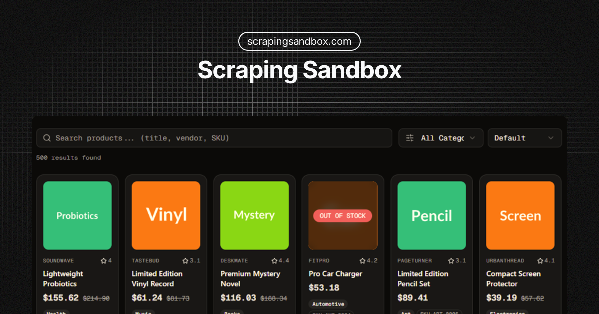

# Spider Archiver

Crawl and archive websites using [spider.cloud](https://spider.cloud). Browse crawled pages in a sidebar, inspect source HTML in a Monaco editor, and download individual pages or full archives.

**Live:** [archiver.spider.cloud](https://archiver.spider.cloud)

[](https://vercel.com/new/clone?repository-url=https%3A%2F%2Fgithub.com%2Fspider-rs%2Fspider-cloud-live-code-viewer&env=NEXT_PUBLIC_SUPABASE_URL,NEXT_PUBLIC_SUPABASE_ANON_KEY&project-name=spider-archiver&repository-name=spider-archiver)



## Features

- Stream-crawl websites via the Spider API and view results in real time
- Multi-URL crawls attribute every page back to the site URL it came from, persisted to IndexedDB; a repeated page URL is overwritten with the newest content instead of duplicated
- Interruption-aware streaming: pages already received stay in the list and are saved when `fetch` or the stream reader fails, with an on-screen interrupted/failed status and a Retry action that re-runs the same URLs using the current configuration
- Page list sidebar with title, URL, source site, size, and status badges
- Read-only Monaco editor with HTML syntax highlighting
- Copy or download individual page source
- Export All — download every crawled page as a single combined HTML file
- Cross-app switcher to jump between all [Spider Cloud](https://spider.cloud) tools with the current URL pre-filled
- Configurable crawl limit, return format (raw / markdown / text), and request mode (HTTP / Chrome / Smart)

## Getting Started

### Prerequisites

- Node.js 18+
- A [spider.cloud](https://spider.cloud) account (free tier available)

### Environment Variables

Create a `.env.local` file:

```env
NEXT_PUBLIC_SUPABASE_URL=<your-supabase-url>
NEXT_PUBLIC_SUPABASE_ANON_KEY=<your-supabase-anon-key>
```

### Development

```bash
npm run dev
# or
yarn dev
# or
pnpm dev
# or
bun dev
```

Open [http://localhost:3001](http://localhost:3001) to see the result.

## Testing

The crawl engine (`lib/crawl.ts`) is fully decoupled from React and accepts
an injected `fetch` implementation, so tests drive it with locally fabricated
JSONL streams (normal lines, lines truncated across chunks, and streams that
throw mid-read) instead of calling the real Spider API. The mock streams in
`tests/helpers/mock-stream.ts` are test scaffolding only and are not part of
the production request path.

```bash
npm test        # run the Vitest suite once
npm run test:watch
```

Key coverage:

- interrupted streams retain already-received pages and those pages are
  persisted to IndexedDB (via `fake-indexeddb`), while a zero-page failure
  persists nothing
- pages from a multi-URL crawl are stamped with their source site and saved
  with that attribution, retrievable through the `sourceUrl` index
- duplicate page URLs overwrite the previous record rather than stacking

## Tech Stack

- [Next.js](https://nextjs.org) 14 (App Router)
- [React](https://react.dev) 18
- [Monaco Editor](https://microsoft.github.io/monaco-editor/) via `@monaco-editor/react`
- [Tailwind CSS](https://tailwindcss.com)
- [Radix UI](https://www.radix-ui.com) primitives (Dialog, Select, Toast)
- [Supabase](https://supabase.com) auth
- [Vercel Analytics](https://vercel.com/analytics)

## Related Spider Cloud Tools

| Tool | URL |
|------|-----|
| Archiver | [archiver.spider.cloud](https://archiver.spider.cloud) |
| Dead Link Checker | [dead-link-checker.spider.cloud](https://dead-link-checker.spider.cloud) |
| A11y Checker | [a11y-checker.spider.cloud](https://a11y-checker.spider.cloud) |
| Knowledge Base | [knowledge-base.spider.cloud](https://knowledge-base.spider.cloud) |
| Perf Runner | [perf-runner.spider.cloud](https://perf-runner.spider.cloud) |
| Content Translator | [content-translator.spider.cloud](https://content-translator.spider.cloud) |
| Diff Monitor | [diff-monitor.spider.cloud](https://diff-monitor.spider.cloud) |
| Sitemap Generator | [sitemap-generator.spider.cloud](https://sitemap-generator.spider.cloud) |
| Link Graph | [link-graph.spider.cloud](https://link-graph.spider.cloud) |

## License

This project is licensed under the [MIT license].

[MIT license]: https://github.com/spider-rs/spider-cloud-live-code-viewer/blob/main/LICENSE