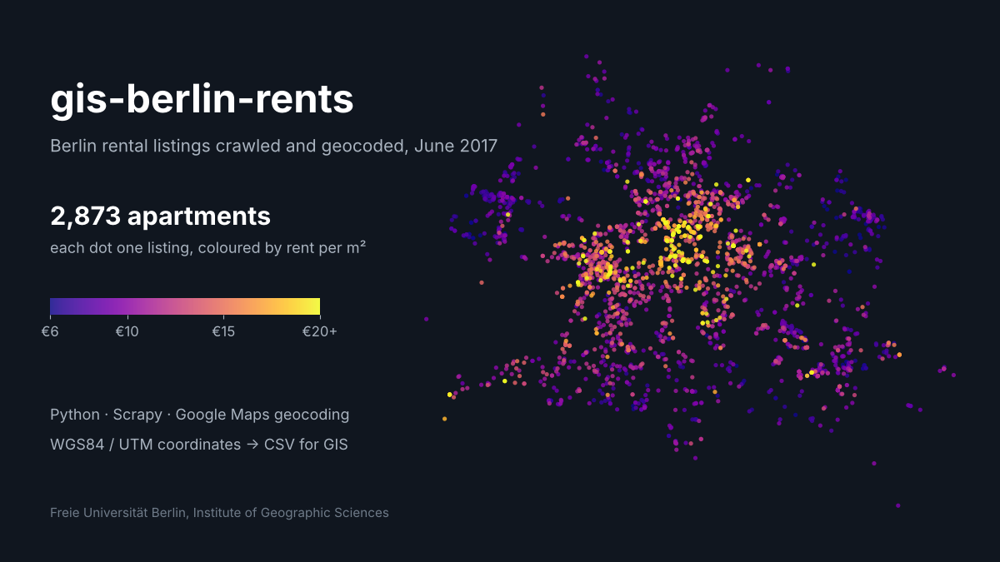

# gis-berlin-rents

## About

This tool crawls information about rental apartments from [immobilienscout24.de](https://www.immobilienscout24.de/Suche/S-T/P-1/Wohnung-Miete/Berlin/Berlin). More specifically in the area of Berlin. The crawled results are stored in a CSV file at the `./out` dir. Following format is used:
 
    price in EUR | flat size in m^2 | number of rooms | address | WGS84 latitude | WGS84 longitude | UTM zone | UTM latitude band | UTM easting coord | UTM northing coord | date of crawling 

Apartments with missing features or having price ranges instead of a fixed price are omitted.
Apartments whose address cannot be geocoded are queued in a separate file instead of being
dropped; see [Failed geocoding and retries](#failed-geocoding-and-retries).

Crawled results are always appended to the file. Based on the apartments' addresses, the coordinates are extracted in a separate step from the Google Maps API. Random delays in between 2 and 10 seconds are added in between each API call to prevent getting blocked.

## Failed geocoding and retries

If an address cannot be geocoded, the apartment is not silently dropped. Its features and the
failure reason are written to `out/apartments-pending.jsonl` (one JSON object per line) next to
the main CSV, which keeps only successfully geocoded rows. A failing request (connection error,
non-JSON answer, HTTP error) never aborts the page: the remaining apartments are still processed.

Each pending record contains `price`, `size`, `rooms`, `address`, `date`, the machine readable
`reason`, a human readable `detail`, the `attempts` counter and the `first_failed_at` /
`last_failed_at` timestamps. The reasons are:

- `incomplete_address`: the address lacks street, district or city information.
- `ambiguous_result`: the geocoding API returned no exact match or more than one exact match.
- `request_error`: the API request itself failed (connection error, HTTP error, invalid JSON).

Retrying is part of the crawl module, not a separate command line tool:

    from is24crawler.collect import retry_pending

    summary = retry_pending()  # uses the configured geocoder and file paths

`run()` in `is24crawler/spiders/immoscout24bot.py` calls `retry_pending()` after the crawl
automatically. Successful retries are appended to the main CSV and removed from the pending file;
apartments that still fail stay in the file with an updated `reason`, `detail`, `attempts` and
`last_failed_at`. Retrying can be repeated as often as needed: the main CSV is checked for
already written apartments (price, size, rooms, address), so no duplicate rows are produced.

## Requirements

- Python 3.5 or higher

## Setup your Python Environment

Make sure to have all required packages installed. You can install them via following command:

        pip install requirements.txt

The `requirements.txt` is located at the project's root.

## Configuration
 
The `settings.py` allows you to adjust following settings:

- USER_AGENT: The user agent string to be used for the web crawler.
- DOWNLOAD_DELAY = The delay in seconds in between crawling each page
- PAGE_START = The page number to start crawling at
- PAGE_END = The number of the last page to be crawled
- CSV_FILE_PATH = The CSV file the successfully geocoded apartments are appended to
- PENDING_CSV_FILE_PATH = The file failed geocodings are queued in
- GEOCODE_TIMEOUT / GEOCODE_MIN_DELAY / GEOCODE_MAX_DELAY = Timeout and random delay range between geocoding API calls

The remaining variables should not be changed unless the crawler needs to be adapted to reflect changes of the website to be crawled.

## Tests

The geocoding failure handling and the retry flow are covered by tests using faked addresses and
geocoding responses, so no real Google request is made:

        python -m pytest tests

`retry_pending()` accepts an injected geocoder as well, which makes it possible to verify the
recovery flow with local fixtures.
