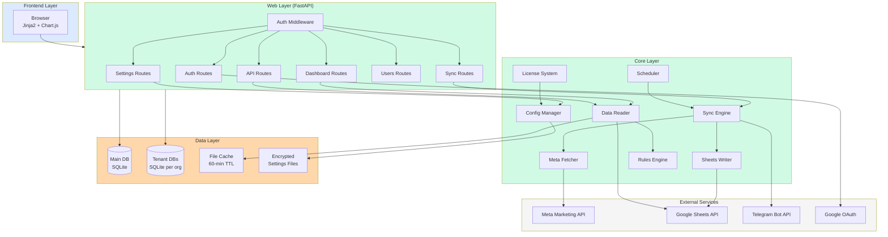
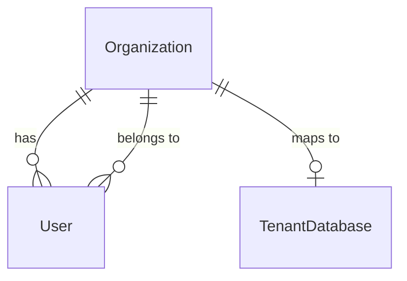
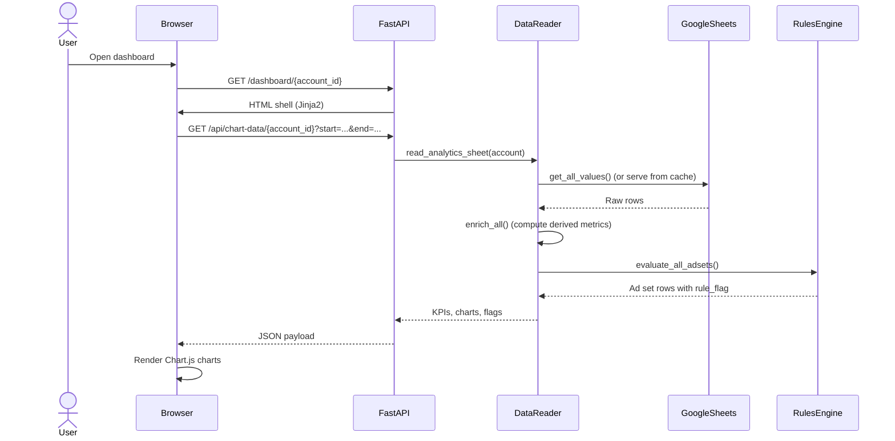

# Meta Ads Intelligence Platform

Media buyers and agencies spend hours each week manually downloading Meta ad reports and building spreadsheets. This platform removes that entirely. It connects directly to the Meta Marketing API, fetches ad data on a configurable schedule, and presents it through a dashboard built for performance analysis rather than raw data browsing.

> **Portfolio Note:** This is a public showcase repository. It contains architecture documentation, design decisions, and skeleton code structure. The full production implementation is proprietary. The engineering depth, system design, and problem-solving approach demonstrated here reflect the real project.

---

[](https://app.url)

> **Demo credentials** — Username: `admin` · Password: `admin123`

---

## Table of Contents

- [Problem Statement](#problem-statement)
- [Solution Overview](#solution-overview)
- [Architecture Overview](#architecture-overview)
- [Features](#features)
- [Technology Stack](#technology-stack)
- [Database Design](#database-design)
- [User Roles and Permissions](#user-roles-and-permissions)
- [System Design Decisions](#system-design-decisions)
- [API Overview](#api-overview)
- [Project Structure](#project-structure)
- [Deployment Architecture](#deployment-architecture)
- [Development Journey](#development-journey)
- [Technical Skills Demonstrated](#technical-skills-demonstrated)
- [Project Metrics](#project-metrics)
- [Screenshots](#screenshots)
- [Case Study](#case-study)
- [Setup](#setup-development-reference-only)
- [License](#license)

---

## Problem Statement

Performance marketers running Meta (Facebook and Instagram) ads face a daily reporting problem. Meta's native interface shows data, but it does not integrate with the spreadsheets, dashboards, and reporting workflows most teams already use. Manually exporting CSVs is slow, error-prone, and breaks every time you need a longer date range.

Beyond raw data, there is no built-in way to automatically flag which ad sets are performing well enough to scale or badly enough to pause. Marketers either eyeball the numbers or build fragile manual processes. Both fail at scale.

Agencies face a harder version of this problem. Each client needs separate data, separate sheets, and separate access. There is no self-hosted tool that handles all of this without paying per-seat SaaS fees.

---

## Solution Overview

The platform connects to Meta's Marketing API and runs syncs on a configurable daily schedule (up to 4 times per day). It writes data to Google Sheets with deduplication so re-running a sync never creates duplicate rows.

The dashboard reads from the sheet, computes a full set of derived metrics, and presents them as KPI cards, daily trend charts, campaign tables, a funnel visualization, a frequency-vs-CTR scatter plot, a day-of-week heatmap, and a platform breakdown.

A rules engine evaluates every ad set against thresholds the user sets. It assigns a flag (scale, pause, watch, or ok) based on spend, ROAS, CTR, or cost-per-lead depending on the business type. After each sync, a Telegram message summarizes what happened.

Multi-tenant architecture means multiple organizations can share one installation without any data crossing between them.

---

## Architecture Overview

The system is a FastAPI application with a background scheduler. The web layer handles authentication, dashboard rendering, and settings management. The core layer handles API communication, data processing, and rules evaluation. A per-tenant database pattern isolates each organization's data completely.

### System Diagram

> View this diagram: open the `.mmd` file in [Mermaid Live Editor](https://mermaid.live)



### Component Breakdown

| Component        | Responsibility                                                      |
| ---------------- | ------------------------------------------------------------------- |
| FastAPI App      | Request routing, middleware, session management, startup hooks      |
| Auth Routes      | Login, registration, Google OAuth, password reset                   |
| Dashboard Routes | HTML page rendering and JSON data endpoints                         |
| Settings Routes  | All configuration management endpoints                              |
| Meta Fetcher     | Paginated calls to the Meta Marketing API                           |
| Sync Engine      | Orchestrates a full sync for one account: fetch, deduplicate, write |
| Sheets Writer    | Writes RAW_DATA and rebuilds the ANALYTICS tab in Google Sheets     |
| Data Reader      | Reads ANALYTICS sheet, caches results, computes derived metrics     |
| Rules Engine     | Groups rows by ad set, evaluates automation rule flags              |
| Scheduler        | APScheduler background jobs for scheduled syncs                     |
| Config Manager   | Loads and saves per-tenant encrypted settings files                 |
| License System   | JWT-based license key decoding and account limit enforcement        |
| Tenant Manager   | Provisions and routes to per-organization SQLite databases          |
| Main DB          | SQLAlchemy models for users, organizations, and tenant DB mappings  |

---

## Features

### Data Sync

**Purpose:** Automatically pull ad performance data from Meta into Google Sheets.

**User Workflow:**

1. User adds a Meta ad account (token + ad account ID + Google Sheet ID) in Settings.
2. User configures sync schedule: enabled/disabled, frequency (1-4 times per day), start time.
3. Sync runs automatically on schedule, or user clicks Sync Now for an immediate run.
4. After each sync, a Telegram message reports success or failure per account.

**Business Value:** Removes manual report downloading. Data is always fresh in Google Sheets. Teams that already work in Sheets get live data without changing their workflow.

**Technical Summary:** Calls the Meta Graph API with pagination handling. Deduplicates rows by date and ad ID before writing. Builds the ANALYTICS tab from RAW_DATA with numeric type cleaning and header formatting applied automatically.

---

### Analytics Dashboard

**Purpose:** Present ad performance data in a way that supports fast decisions without exporting anything.

**User Workflow:**

1. User selects an account and a date range (preset or custom).
2. Dashboard loads KPI cards, then charts, then the full ad table via separate JSON calls.
3. User can switch date ranges, apply filters, or change the business type.

**Business Value:** Replaces the need to open the Google Sheet for day-to-day analysis. All key metrics visible in one view with period-over-period change percentages.

**Technical Summary:** FastAPI JSON endpoints serve pre-computed chart data, KPI summaries, and paginated table data. The browser caches responses for 60 minutes. Chart.js renders all visualizations client-side.

**Charts included:**

- KPI summary cards with percent change vs prior period
- Daily trend line chart (any metric)
- Campaign breakdown table sorted by spend
- Per-campaign metric trend chart (top 5 campaigns)
- Funnel: Impressions to Clicks to Add-to-Cart to Checkout to Purchase (or Leads)
- Frequency vs CTR scatter plot per ad
- Day-of-week heatmap (spend, CTR, ROAS, CPM, frequency, reach)
- Platform breakdown (Facebook, Instagram, Audience Network, Messenger)

---

### Calculated Metrics

**Purpose:** Expose standard performance metrics that Meta does not return directly from the API.

**Metrics added per row:**

- Hook Rate % (video plays / impressions)
- Hold Rate % (video completions / video plays)
- Thumb Stop Rate % (25% video views / impressions)
- Link CTR % (inline link clicks / impressions)
- CVR % (purchases / clicks)
- ATC Rate % (add-to-carts / clicks)
- Checkout Rate % (checkouts / add-to-carts)
- Cost Per Lead
- Cost Per ATC
- Average Order Value

**Business Value:** These metrics are the language of creative performance analysis. Having them automatically computed removes the manual spreadsheet formulas most teams maintain separately.

---

### Filtering System

**Purpose:** Narrow down the ad table to only the rows that matter for a given analysis.

**User Workflow:**

1. User opens the filter panel and sets one or more conditions.
2. Active filter chips appear showing exactly what is applied.
3. Each filter chip shows how many ads pass the condition out of the total.
4. Filters can be cleared individually or all at once.

**Metrics that can be filtered:** Spend, ROAS, CTR, Unique CTR, CPC, CPM, CPP, Impressions, Reach, Frequency, Clicks, Inline Clicks, Purchases, Leads, Add-to-Carts, Checkouts, Purchase Value, Cost Per Purchase, Hook Rate, Hold Rate, Thumb Stop Rate, Link CTR, CVR, ATC Rate, Checkout Rate, Cost Per Lead, Cost Per ATC, AOV, and more.

**Operators:** greater-than, less-than, greater-or-equal, less-or-equal.

**Special filters:** Campaign name, ad set name, automation rule flag, above-break-even-ROAS toggle.

---

### Automation Rules Engine

**Purpose:** Automatically classify ad sets as scale, pause, watch, or ok based on thresholds the user defines.

**User Workflow:**

1. User sets a pause rule: minimum spend, minimum days running, and metric conditions.
2. User sets a scale rule: minimum spend, minimum days running, and metric conditions.
3. After each sync, all ad sets are evaluated against the active rules.
4. Dashboard shows rule flag counts and lets users filter to only flagged ad sets.

**Business Value:** Removes the daily manual review of dozens of ad sets. The system flags what needs attention so the marketer only looks at what matters.

**Business type modes:**

- Ecommerce: ROAS and CTR based evaluation
- Lead Generation: cost-per-lead vs target CPL threshold
- Awareness: frequency-based flagging for high-frequency ad sets

**Technical Summary:** Core scoring logic is proprietary and not included in this public version.

---

### Multi-Tenant Architecture

**Purpose:** Host multiple clients or organizations on a single installation without any data mixing.

**Isolation model:** Each organization gets a separate SQLite database, a separate encrypted settings file, and a separate file cache directory. No query can cross organization boundaries.

**Technical Summary:** A ContextVar propagates the active organization ID for the duration of each request. The config manager and tenant manager resolve all file paths relative to the current organization context.

---

### Multi-Account Support

**Purpose:** Let each organization manage multiple Meta ad accounts, each with its own Google Sheet.

**Features:**

- Add, edit, and delete accounts from the Settings page.
- Live token validation before saving (calls the Meta API immediately to confirm the token works).
- Delete requires password confirmation.
- Account limit is enforced by the license key.

---

### User Management

**Purpose:** Let admins create and manage staff accounts within their organization.

**Roles:** Admin and Staff. Admins can access Settings and Users. Staff see only the dashboard.

---

### License System

**Purpose:** Control how many ad accounts each organization can add.

**Technical Summary:** JWT-based license key decoding. License key shows client name, expiry, and account limit. License validation logic is proprietary and not included in this public version.

---

### Notifications

**Purpose:** Send a summary message after every sync without requiring the user to check the dashboard.

**Features:** Telegram bot integration with per-account status. Test message button in Settings.

---

## Technology Stack

> View this diagram: open the `.mmd` file in [Mermaid Live Editor](https://mermaid.live)

| Layer                 | Technology                      | Why Chosen                                                            |
| --------------------- | ------------------------------- | --------------------------------------------------------------------- |
| Web Framework         | FastAPI                         | Async-first, automatic request validation, clean dependency injection |
| ASGI Server           | Uvicorn                         | High-performance async server for FastAPI                             |
| Templates             | Jinja2                          | Server-side HTML rendering with layout inheritance                    |
| Session Management    | Starlette SessionMiddleware     | Cookie-based sessions with configurable expiry                        |
| Database (main)       | SQLite via SQLAlchemy           | Zero-config relational store for users and org metadata               |
| Database (per-tenant) | SQLite per organization         | Complete data isolation without a database server                     |
| Password Hashing      | bcrypt via passlib              | Industry standard adaptive hash for stored passwords                  |
| JWT                   | PyJWT                           | License key decoding and auth token handling                          |
| Encryption            | Fernet (cryptography)           | Symmetric encryption for settings files at rest                       |
| Task Scheduling       | APScheduler BackgroundScheduler | In-process cron scheduling with reschedule-on-save                    |
| Meta API Client       | requests                        | Synchronous HTTP with pagination and error handling                   |
| Google Sheets         | gspread + oauth2client          | Service account authentication and sheet read/write                   |
| Google OAuth          | httpx                           | Async HTTP for OAuth token exchange                                   |
| Email                 | smtplib                         | Standard library SMTP for password reset emails                       |
| Telegram              | requests                        | Simple bot API calls for sync notifications                           |
| Frontend Charts       | Chart.js (CDN)                  | Flexible chart library with no build step required                    |
| Env Config            | python-dotenv                   | Twelve-factor app environment variable loading                        |

---

## Database Design

### Entity Overview

> View this diagram: open the `.mmd` file in [Mermaid Live Editor](https://mermaid.live)



### Table Purposes

| Table            | Purpose                                             | Relationships                        |
| ---------------- | --------------------------------------------------- | ------------------------------------ |
| organizations    | Stores each tenant organization                     | Parent of users and tenant_databases |
| users            | Stores all user accounts across all organizations   | Belongs to one organization          |
| tenant_databases | Maps organization IDs to their tenant DB file names | One-to-one with organizations        |

**Per-tenant databases** (separate SQLite file per organization):

| Store               | Type           | Purpose                                                      |
| ------------------- | -------------- | ------------------------------------------------------------ |
| settings.json       | Encrypted file | All account credentials, sync config, automation rules       |
| google-api-key.json | File           | Google service account key for Sheets API                    |
| cache/*.json        | File           | 60-minute sheet data cache per ad account                    |
| sync_status.json    | File           | Last sync result per account (status, rows added, timestamp) |

---

## User Roles and Permissions

| Role  | Description                                       | Key Permissions                                          |
| ----- | ------------------------------------------------- | -------------------------------------------------------- |
| Admin | Organization owner, created on first registration | Dashboard, Settings (all), User management, Sync control |
| Staff | Team member, created by admin                     | Dashboard only (read access)                             |

---

## System Design Decisions

### Design Patterns Used

- **Service Layer:** Core logic (meta_fetcher, sync_engine, data_reader, rules_engine) is completely separated from web routing. Routes call service functions; they do not contain business logic.
- **Repository Pattern (light):** config_manager provides a single interface for loading and saving tenant settings regardless of where those files are on disk.
- **Context Variable for Tenant Isolation:** A Python ContextVar carries the active organization ID for the lifetime of each request, letting all service functions resolve the correct tenant path without threading or explicit parameter passing.
- **Cache-Aside:** data_reader checks a file cache before calling Google Sheets. A sync invalidates the cache so the next dashboard load always sees fresh post-sync data.
- **Background Scheduler:** APScheduler runs sync jobs in-process. The scheduler is reconfigured immediately when the user saves new sync settings, with no restart required.

### Multi-Tenancy Approach

Each registered organization is isolated at three levels. First, it gets its own SQLite database file stored under `data/tenants/`. Second, all settings (including API credentials) are stored in a per-tenant encrypted file. Third, Google Sheets cache files are namespaced by organization and account ID. No SQL query or file read can cross organization boundaries because all paths are resolved through the tenant context.

### Security Approach

Authentication uses email and password with bcrypt hashing, or Google OAuth as an alternative. Sessions are cookie-based with a 24-hour expiry. All protected routes check session state via middleware before request handlers run. Settings files containing API credentials are encrypted at rest using Fernet symmetric encryption. The encryption key is loaded from the environment, never hardcoded. Role-based access control (admin vs staff) is enforced at the route level for settings and user management endpoints.

### Scalability Approach

The current design is optimized for single-server deployment with moderate data volumes. The 60-minute client-side cache prevents repeated Google Sheets API calls during heavy dashboard use. Sync jobs run in background threads managed by APScheduler, so they do not block web request handling. For larger deployments, the scheduler could be extracted to a separate worker process, and the SQLite databases could be replaced with PostgreSQL per tenant.

---

## API Overview

> View this diagram: open the `.mmd` file in [Mermaid Live Editor](https://mermaid.live)



### Endpoint Categories

| Category  | Purpose                                | Auth Required     |
| --------- | -------------------------------------- | ----------------- |
| Auth      | Login, register, OAuth, password reset | No (public pages) |
| Dashboard | HTML page and JSON data endpoints      | Yes               |
| Settings  | All configuration management           | Yes (admin only)  |
| Sync      | Manual sync trigger                    | Yes (admin only)  |
| Users     | Create and delete staff accounts       | Yes (admin only)  |
| API       | Super-admin health and status          | API key required  |

---

## Project Structure

```
meta-ads-intelligence-public/
├── README.md                        <- You are here
├── ARCHITECTURE.md                  <- Deep technical architecture
├── FEATURES.md                      <- Full feature documentation
├── DATABASE_OVERVIEW.md             <- Schema and data model
├── DEPLOYMENT_OVERVIEW.md           <- Infrastructure and deployment
├── SECURITY_OVERVIEW.md             <- Security model
├── CASE_STUDY.md                    <- Client-facing project story
├── .env.example                     <- Environment variable template
├── src/
│   ├── run.py                       <- Entry point (Uvicorn)
│   ├── core/
│   │   ├── meta_fetcher.py          <- Meta Marketing API client
│   │   ├── sync_engine.py           <- Sync orchestration
│   │   ├── sheets_writer.py         <- Google Sheets writer
│   │   ├── row_builder.py           <- API response to row mapper
│   │   ├── data_reader.py           <- Sheet reader, cache, metrics
│   │   ├── rules_engine.py          <- Automation rules (skeleton)
│   │   ├── scheduler.py             <- APScheduler setup
│   │   ├── config_manager.py        <- Encrypted settings manager
│   │   └── license.py               <- License key system (skeleton)
│   ├── db/
│   │   ├── main_db.py               <- SQLAlchemy models
│   │   ├── tenant_manager.py        <- Per-org DB provisioning
│   │   └── password.py              <- bcrypt wrapper
│   ├── web/
│   │   ├── app.py                   <- FastAPI app and middleware
│   │   └── routes/
│   │       ├── auth.py
│   │       ├── dashboard.py
│   │       ├── settings.py
│   │       ├── sync.py
│   │       ├── setup.py
│   │       ├── users.py
│   │       └── api.py
│   └── scripts/
│       └── migrate_existing.py
├── docs/
│   ├── diagrams/
│   │   ├── architecture.mmd
│   │   ├── feature-flow.mmd
│   │   ├── tech-stack.mmd
│   │   └── er-diagram.mmd
│   └── screenshots/
│       └── README.md
└── LICENSE
```

---

## Deployment Architecture

```
Local Development
    python run.py  ->  http://localhost:8000

Production (Linux VPS)
    systemd service  ->  Uvicorn  ->  FastAPI
    Nginx reverse proxy  ->  https://your-domain.com  ->  http://127.0.0.1:8000

Docker
    docker run (env-file .env, volumes: data/, logs/)  ->  port 8000
```

| Environment | Stack                           | Purpose                                                |
| ----------- | ------------------------------- | ------------------------------------------------------ |
| Development | Python + Uvicorn (reload mode)  | Local development with auto-reload                     |
| Production  | systemd + Uvicorn + Nginx/Caddy | Always-on server with HTTPS termination                |
| Docker      | Docker + Uvicorn                | Portable deployment with volume mounts for persistence |

---

## Development Journey

### Key Challenges Solved

- **Deduplication across incremental syncs.** The Meta API can return the same date range more than once if settings change. A key-based deduplication layer (date + ad ID) ensures no row is written twice, making the system safe to re-run without audit cleanup.
- **Tenant context propagation without framework magic.** Passing an organization ID through every function call would have required rewriting the entire call chain. A Python ContextVar solved this by making the current tenant ID available anywhere in the call stack for the duration of one request.
- **Encrypted settings files per tenant.** Storing API credentials (Meta tokens, Google keys) in plaintext files is a security risk. Fernet symmetric encryption applied transparently by the config manager means credentials are never readable at rest.
- **Cache invalidation timing.** A 60-minute cache avoids hammering the Google Sheets API on every dashboard load, but it must be cleared immediately after a sync so users see fresh data. Tying cache invalidation to the sync completion step solved this without needing a message queue.
- **Schedule reschedule without restart.** APScheduler supports dynamic job modification. When the user changes sync settings and clicks Save, the scheduler clears existing sync jobs and adds new ones with the updated frequency and time, all without restarting the server.

### Architectural Decisions

**SQLite per tenant vs a shared PostgreSQL database.** A shared database would require a tenant_id column on every table and careful query scoping. Separate SQLite files per tenant provide hard isolation by construction. The tradeoff is that cross-tenant queries are impossible (acceptable, since that is the goal) and SQLite has write concurrency limits (acceptable given one active user per org at a time).

**Google Sheets as the data store vs an internal database.** Storing ad data in the app's own database would be faster for queries but would disconnect users from the Google Sheets workflow many teams already have. Keeping Sheets as the primary data store means the data is always accessible outside the app. The 60-minute cache layer recovers the performance tradeoff for dashboard loading.

**In-process scheduling vs an external worker.** An external queue (Celery, RQ) adds infrastructure complexity. APScheduler running inside the FastAPI process is simpler to deploy and sufficient for the expected sync frequency (at most 4 times per day). The cost is that the scheduler shares memory with the web process; for high-volume deployments, the worker would be extracted.

---

## Technical Skills Demonstrated

- **Backend:** FastAPI async routing, background task scheduling, middleware chain design, JWT handling, Fernet encryption
- **Database:** SQLAlchemy ORM, multi-database architecture, per-tenant isolation, context variable propagation
- **API Integration:** Meta Marketing API pagination, Google Sheets read/write with service account auth, Google OAuth flow, Telegram Bot API
- **Architecture:** Multi-tenant design, service layer separation, cache-aside pattern, role-based access control
- **Data Processing:** Ad metric enrichment, aggregation, filtering, funnel analysis, day-of-week heatmaps, scatter data preparation
- **DevOps:** systemd service deployment, Docker containerization, Nginx reverse proxy, rotating log files
- **Security:** bcrypt password hashing, Fernet file encryption, session-based auth, RBAC enforcement at route level

---

## Project Metrics

| Metric                        | Value                        |
| ----------------------------- | ---------------------------- |
| Total modules                 | 14                           |
| API endpoints                 | 30+                          |
| Database tables               | 3 (main) + per-tenant schema |
| Major features                | 10                           |
| Calculated metrics per ad row | 10                           |
| Filterable metrics            | 30+                          |
| Chart types                   | 8                            |
| Estimated complexity          | High                         |

---

## Screenshots

> Live demo available upon request. Screenshots provided during private demo session.

| Screen    | Description                                                                 |
| --------- | --------------------------------------------------------------------------- |
| Dashboard | KPI cards, daily trend chart, campaign table, funnel, heatmap, scatter plot |
| Settings  | Account management, sync schedule, automation rules, Telegram config        |
| Users     | Admin user list with create and delete actions                              |
| Login     | Email/password and Google OAuth options                                     |

---

## Case Study

> See [CASE_STUDY.md](CASE_STUDY.md) for the full project story, challenge, approach, and outcome.

---

## Setup (Development Reference Only)

> This public version contains skeleton code and is **not runnable**.
> Contact me for a private demo or to discuss the full implementation.

### Prerequisites

- Python 3.11 or newer
- A Meta ad account with a valid access token
- A Google Cloud project with Sheets API and Drive API enabled
- A Google service account with a JSON key file
- A Google Sheet shared with the service account as Editor
- (Optional) Telegram bot token and chat ID
- (Optional) Google OAuth credentials

### Environment Variables

```env
# Copy .env.example and fill in your values
SECRET_KEY=YOUR_VALUE_HERE
JWT_SECRET=YOUR_VALUE_HERE
SESSION_SECRET=YOUR_VALUE_HERE
```

See `.env.example` for the full list of required variables.

---

## License

This repository is published for portfolio and demonstration purposes only.
All code is skeleton/placeholder and does not represent the production implementation.
All proprietary business logic and algorithms are retained by the author.

Copyright 2025 Abu Salah Mohammad Asif. All rights reserved.
