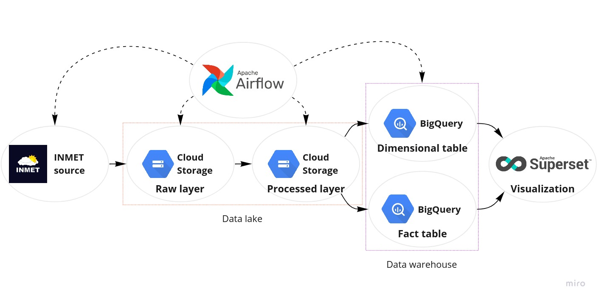
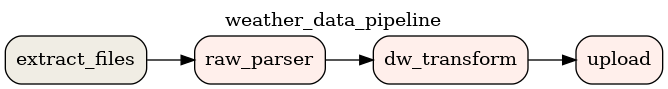
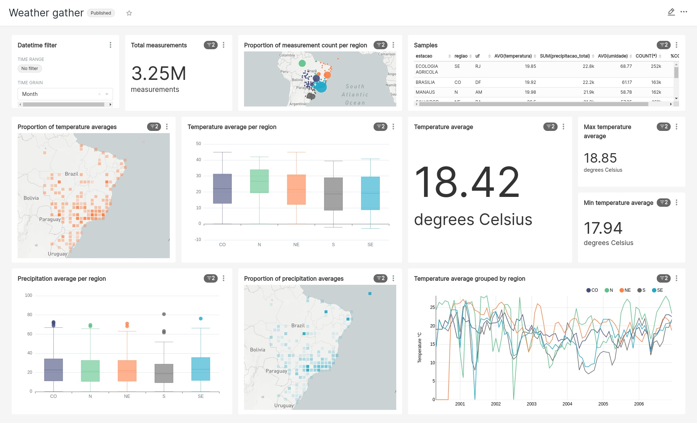

# INMET Weather Stations Data Pipeline

<p>


</p>

This project extracts historical weather data from Brazil's [INMET](https://portal.inmet.gov.br/dadoshistoricos) open-data archives, transforms it with Apache Airflow, loads it into Google Cloud Storage and BigQuery, and visualizes it with Apache Superset.



## Overview

INMET publishes yearly ZIP archives (for example, `2000.zip`) containing CSV files in a non-standard layout. The pipeline handles that format end to end:

1. **Extract** — Download and unzip yearly archives from INMET.
2. **Parse** — Read station metadata (coordinates, region, city) from CSV headers and normalize weather measurements (temperature, humidity, wind, precipitation, and more).
3. **Transform** — Build a small data warehouse with `dim_estacoes` (station dimension) and `fact_medicoes` (hourly measurements).
4. **Load** — Upload dimension and fact tables to BigQuery.
5. **Visualize** — Explore the dataset and build dashboards in Superset.

The Airflow DAG `weather_data_pipeline` runs on a yearly schedule (`@yearly`) with `catchup=True`, so each run processes one reference year based on the execution date. Data moves through GCS prefixes that act as buckets: `loading_zone`, `raw`, `processed`, and `dw`.

## Prerequisites

- [Docker](https://docs.docker.com/get-docker/) and Docker Compose
- A Google Cloud project with billing enabled
- Permission to create GCS buckets and BigQuery datasets
- A [Mapbox API key](https://mapbox.com/) (required for map charts in Superset)

## Project structure

```text
.
├── airflow/          # Airflow DAG, operators, and Docker setup
├── terraform/        # GCP bootstrap (GCS bucket + BigQuery dataset)
├── superset/         # Superset Docker setup and configuration
└── img/              # Architecture diagram, DAG screenshot, and dashboard preview
```

Each service directory includes a `Makefile`. Run `make help` inside any of them to list available commands.

## How to use

### 1. Terraform

Provision the GCS bucket and BigQuery dataset:

```shell
cd terraform

make build

make start \
    BQ_DATASET=<YOUR_DATASET_ID> \
    GCS_BUCKET=<YOUR_GCS_BUCKET_NAME> \
    GOOGLE_CLOUD_PROJECT=<YOUR_PROJECT_NAME>

make gcloud
```

Authenticate with Google Cloud, then apply the Terraform configuration:

```shell
make shell

terraform -chdir=gcp init
terraform -chdir=gcp plan
terraform -chdir=gcp apply
```

To stop the Terraform container:

```shell
make stop
```

### 2. Apache Airflow

Build and start Airflow, then run the pipeline:

```shell
cd airflow

make build

make up \
    BQ_DATASET=<YOUR_DATASET_ID> \
    GCS_BUCKET=<YOUR_GCS_BUCKET_NAME> \
    GOOGLE_CLOUD_PROJECT=<YOUR_PROJECT_NAME>

make gcloud
make start
```

- **Airflow UI:** http://localhost:8080
- **Default login:** `admin` / `admin`

The `make start` command unpauses the `weather_data_pipeline` DAG. Monitor task progress in the Airflow UI. The DAG flow should look like this:

<p align="center">

</p>

To stop Airflow:

```shell
make stop
```

### 3. Apache Superset

Start Superset to explore the BigQuery tables:

```shell
cd superset

make build

make start \
    GOOGLE_CLOUD_PROJECT=<YOUR_PROJECT_NAME> \
    MAPBOX_API_KEY=<YOUR_MAPBOX_API_KEY>

make gcloud
```

- **Superset UI:** http://localhost:8088
- **Default login:** `admin` / `admin`

After signing in:

1. Connect Superset to your BigQuery dataset (use the same GCP project authenticated with `make gcloud`).
2. Optionally import dashboard exports into `superset/dashboards/` (the directory is mounted into the container at startup).
3. Configure the Mapbox API key in Superset settings to enable map visualizations.

Example dashboard:



To stop Superset:

```shell
make stop
```

## Data model

| Table | Description |
| --- | --- |
| `dim_estacoes` | Station locations, regions, states, and founding dates |
| `fact_medicoes` | Hourly weather measurements linked to stations |

Both tables are written to the `dw` GCS prefix during transformation and appended to the configured BigQuery dataset during the upload task.

## References

- [INMET historical data portal](https://portal.inmet.gov.br/dadoshistoricos)
- [Apache Airflow documentation](https://airflow.apache.org/docs/stable/howto/index.html)
- [Apache Superset documentation](https://superset.apache.org/docs/intro)
- [Mapbox](https://mapbox.com/)
