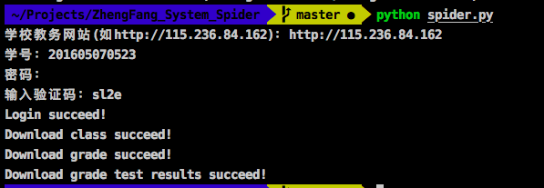
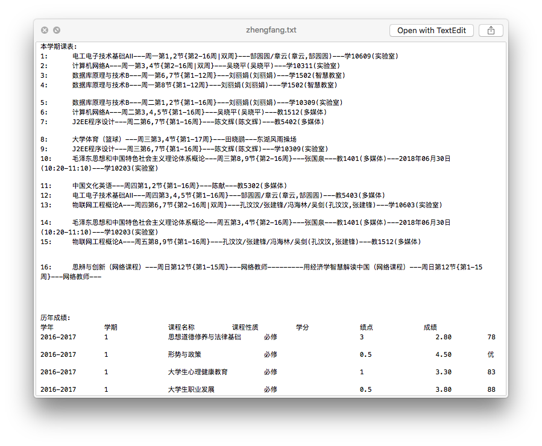

# ZhengFang_System_Spider
对正方教务管理系统个人课表，学生成绩，绩点等简单爬取

## 依赖环境
python 3.6
### python库
http请求：requests，urllib  
数据提取：re，lxml，bs4  
存储相关：os，sys  
验证码处理：PIL  

## 下载安装
在终端输入如下命令：
```bash
git clone https://github.com/ZYSzys/ZhengFang_System_Spider.git
```

## 使用方法

### 安装依赖包
```bash
pip install -r requirements.txt
```

### 运行
在当前目录下输入：
```
cd ZhengFang_System_Spider
python spider.py
```
运行爬虫，按提示输入学校教务网，学号，密码，输入验证码  



稍等几秒钟，当前ZhengFang_System_Spider文件夹下就会生成zhengfang.txt  
个人课表，成绩绩点均已保存到该文本文件中



## 分段采集与容错

一次采集按 **课表、历年成绩、等级考试成绩** 三段独立执行，任一段请求或解析出错都不会中断其他段：

- 每段先在内存中完成请求与解析，得到完整结果后才统一落盘；解析失败不会改动该段已有内容，也不会留下半截表格。
- 写入采用同目录临时文件 + 原子替换，任何写入异常都不会损坏 zhengfang.txt。
- 文件末尾的“采集分段结局”逐段记录 **段名、成功/失败/未执行、失败原因**，失败原因分为三类：
  - 登录失效：会话过期，服务端把请求踢回了登录页；
  - 页面结构不符：返回的 HTML 与解析器预期结构不一致；
  - 网络请求异常：连接超时、连接被拒绝、DNS 失败等网络层错误。
- 登录失败时三段均标记为“未执行”并给出原因，进程以退出码 2 结束；任一段失败退出码为 1；三段全部成功退出码为 0。

## 离线测试（不依赖真实教务网）

测试使用 `tests/samples/` 下自造的 HTML 样例和假 requests 会话，覆盖全部成功、结构损坏、网络异常、登录失效、登录失败以及旧内容保留等场景：

```bash
python -I tests/test_spider.py
```

