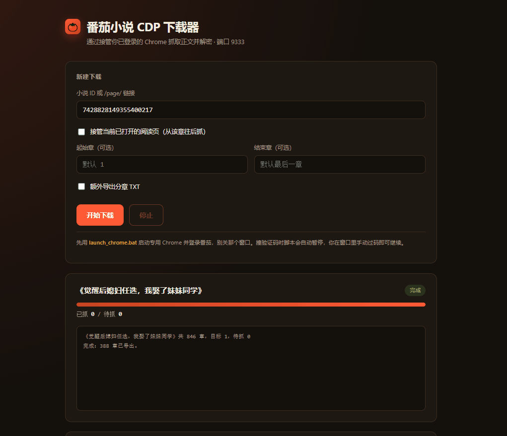

# 番茄小说 CDP 下载器

[](LICENSE)
[](https://www.python.org/)
[](https://playwright.dev/)
[](#环境要求)


一条命令，从番茄小说批量抓取整本正文，自动还原字体加密、断点续传、附带本地 Web 界面。



> ## ⚠️ 免责声明
>
> - 本项目**仅供个人学习、技术研究与交流使用**，旨在探讨 CDP 自动化、反爬与字体反混淆等技术。
> - 抓取到的所有小说内容**版权归原作者及番茄小说平台所有**。请勿下载、传播、分享或用于任何商业用途。
> - 请在下载后 24 小时内删除，**支持正版，尊重创作者**。
> - 使用本工具即表示你已知悉并同意：由使用本工具产生的一切后果（包括但不限于账号封禁、法律责任）**由使用者自行承担**，与本项目作者无关。
> - 本项目不提供任何小说内容，不与番茄小说官方有任何关联。若本项目侵犯了您的合法权益，请联系删除。

用 **CDP 远程控制你自己登录的 Chrome** 来批量抓取番茄小说正文。

相比直接用 requests 抓取，这种方式复用真实登录态、真实指纹和热 cookie，
风控命中率低；万一撞上验证码，可以在真窗口里手动过码，脚本会自动检测并续爬。

正文抓下来后，用内置字体映射表（`charset.json`）把番茄的 PUA 私用区密文
解密回真实汉字。实测《十日终焉》1496 章、329 万字全部抓取，解密还原率 100%。

## ✨ 技术亮点

- **CDP 接管真实浏览器绕过前端风控**：不用 requests 硬刚，而是通过 Chrome DevTools Protocol 接管你手动登录的真实 Chrome，复用真实指纹与 cookie，风控命中率极低。
- **PUA 私用区字体反混淆**：番茄正文是私用区密文，用字体映射表逐字还原为明文，实测 1496 章 / 329 万字还原率 100%。
- **无人值守续爬**：检测到验证码时轮询等待而非阻塞，人工过码后自动感知续爬；后台运行不崩。
- **断点续传**：进度实时写入 JSON 中间态，任意中断后重跑相同命令自动跳过已完成章节。
- **分层模块化架构**：抓取 / 解密 / 存储 / 编排 / 服务解耦，CLI 与 FastAPI Web 服务共用同一套核心。

## 工作原理

1. 用专用 profile + 调试端口（9333）启动一个独立 Chrome 实例，你在里面登录番茄。
2. 脚本通过 Playwright `connect_over_cdp` **接管**这个实例，不另起浏览器。
3. 目录页（`/page/{id}`）用 requests 直接抓，拿到书名和章节列表。
4. 逐章导航到阅读页（`/reader/{id}`），等前端渲染出正文节点，取 DOM 文本。
5. 正文是 PUA 密文，用 `charset.json` 映射解密成明文。
6. 边抓边存 JSON 中间态（断点续传），最后导出 TXT。

## 环境要求

- Windows + 已安装 Chrome
- Python 3.9+
- 一个番茄小说账号（用来在专用 Chrome 里登录）

## 安装

```powershell
cd fanqie-cdp-downloader
pip install -r requirements.txt
python -m playwright install chromium   # 首次需要，装 Playwright 驱动
```

## 使用步骤

### 1. 启动专用 Chrome 并登录

双击 `launch_chrome.bat`（或在 PowerShell 里跑 `launch_chrome.ps1`）。
会弹出一个独立的 Chrome 窗口（用 `data\chrome-profile` 目录，与日常浏览器隔离），
自动打开番茄首页。**在这个窗口里登录番茄，然后别关它。**

登录态会持久保存在专用 profile 里，之后再启动无需重复登录。

### 2. 下载

```powershell
cd src

# 方式一：给小说 ID 或 /page/ 链接，从头抓整本
python downloader.py --novel 7143038691944959011 --split

# 方式二：只抓指定章节范围（1-based，含端点）
python downloader.py --novel 7143038691944959011 --start 1 --end 50

# 方式三：接管当前已打开的阅读页，从该章起往后抓
#   先在专用 Chrome 里翻到你想开始的那一章，再运行：
python downloader.py --attach --split
```

### 参数说明

| 参数 | 说明 |
|------|------|
| `--novel <ID/链接>` | 小说 ID 或 `/page/{id}` 链接。与 `--attach` 二选一 |
| `--attach` | 接管当前已打开的番茄阅读页，自动解析所属小说与起始章 |
| `--start N` | 起始章节序号（1-based，含）。默认从第 1 章 |
| `--end M` | 结束章节序号（含）。默认到最后一章 |
| `--split` | 除单文件 TXT 外，额外导出分章 TXT |
| `--save-every N` | 每抓 N 章落盘一次中间态（默认 5） |

## Web 服务（可选，更方便）

不想记命令行，可以起一个本地网页来操作：填 ID 点按钮下载、实时看进度、
下载成品 TXT。

```powershell
cd src
uvicorn service:app --host 127.0.0.1 --port 8000
```

然后浏览器打开 http://127.0.0.1:8000 。前提同样是专用 Chrome 已用
`launch_chrome` 起好并登录。

页面支持：
- 输入小说 ID/链接下载，或勾选“接管当前已打开的阅读页”
- 可选起始/结束章、是否导出分章
- 实时进度条 + 抓取日志、随时“停止”（进度已保存可续传）
- 已下载书籍列表，一键下载单文件 TXT

服务是**单任务模型**：浏览器是共享单例（串行单标签的反爬设计），同一时刻只跑
一个下载，已在运行时会拒绝新任务。下载在后台线程执行，前端轮询 `/api/status`。

| 端点 | 说明 |
|------|------|
| `GET /` | 网页界面 |
| `POST /api/start` | 启动下载（body: novel/attach/start/end/split） |
| `POST /api/stop` | 请求停止当前任务 |
| `GET /api/status` | 当前任务进度快照 |
| `GET /api/books` | 已下载书籍列表 |
| `GET /api/download/{book_dir}` | 下载某本书的单文件 TXT |

## 输出

每本书一个目录：`output\<书名>_<小说ID>\`

```
output/十日终焉_7143038691944959011/
├── content.json          # JSON 中间态（断点续传的权威数据源）
├── 十日终焉.txt          # 单文件：整本小说
└── 十日终焉_chapters/    # 分章（仅 --split 时生成）
    ├── 0001_第1章 空屋.txt
    └── ...
```

## 断点续传

抓取进度实时写入 `content.json`。中断后（关窗口、断网、Ctrl+C、撞验证码超时）
再次运行**相同命令**，已抓到的章节会自动跳过，从断点接着抓。

## 反爬与速度

- **章间延迟**：`src/config.py` 里的 `DELAY_RANGE`（秒区间）。默认极限档 `(0.0, 0.3)`
  最快；若频繁撞验证码，调大到 `(0.5, 1.2)` 或 `(1.2, 3.0)` 更稳。
- **验证码**：抓取中若检测到验证/风控页，脚本会**暂停并轮询等待**，你在专用 Chrome
  窗口里手动完成验证即可，脚本自动感知后继续（默认最长等 10 分钟）。
- 默认串行单标签，不并发，最大程度贴近真人浏览行为。

## 常见问题

**启动 Chrome 报「找不到 remote debugging port」？**
说明 `chrome.exe` 路径没匹配到。编辑 `launch_chrome.bat` 里的 `CHROME` 路径。

**「无法连接 CDP」？**
先确认专用 Chrome 已经用 `launch_chrome` 脚本起好、调试端口 9333 开着。
浏览器关了就连不上。

**控制台里中文是乱码？**
Windows 控制台的显示问题，不影响落地文件——`content.json` 和 TXT 都是正确的 UTF-8。

**换一本书怎么抓？**
从番茄书籍页复制 `/page/{id}` 链接或其中的数字 ID，传给 `--novel`。

## 项目结构

```
src/
├── config.py         # 端口、路径、PUA 码位、延迟档位
├── decoder.py        # PUA 密文解密 + charset 健康自检
├── browser.py        # CDP 连接、页面查找、验证码检测/等待
├── catalog.py        # 目录抓取（书名 + 章节列表）
├── extractor.py      # 单章：导航 → 取正文 → 解密
├── storage.py        # JSON 中间态 + TXT 导出
├── downloader.py     # 编排入口（CLI）
├── task_manager.py   # 单任务下载管理器（后台线程 + 进度快照）
├── service.py        # FastAPI 服务（网页 + API）
├── probe.py          # 探针（验证选择器与 charset 是否可用）
└── charset.json      # 字体映射表
webapp/
└── index.html        # Web 界面（单文件）
```

## License

本项目基于 [MIT License](LICENSE) 开源。
