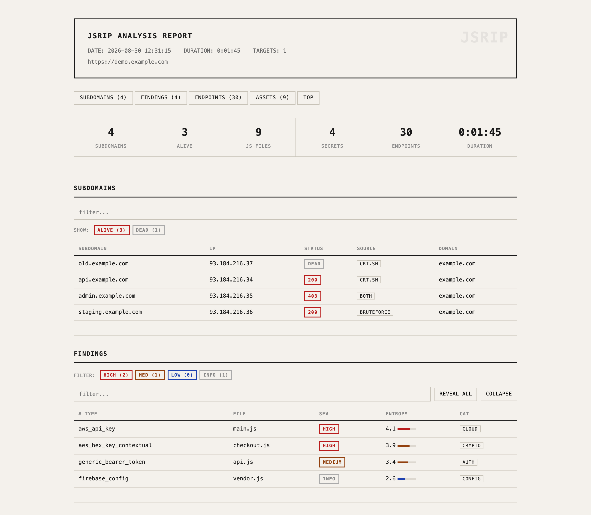

# jsrip

JavaScript ripper for the offensive web. Crawls targets, rips their JS, and tears it apart looking for secrets, endpoints, and things developers forgot to hide.

Built for bug bounty hunters and pentesters who are tired of doing this by hand.

---

## What it looks like

```
============================================================
  jsrip - JavaScript Ripper & Analyzer
============================================================
  Targets: 1

  [1/4] Crawling and ripping JavaScript...
INFO: Scope domains: target.com
INFO: Crawling: https://target.com (depth: 0)
INFO: Crawling: https://target.com/#/score-board (depth: 1)
INFO: Crawling complete. Found 9 JavaScript files
        9 JS files pulled

  [2/4] Analyzing for secrets and endpoints...
        1 potential secrets
        30 endpoints

  [3/4] Running JS intel pass...
        4 app files (rest classified as vendor/inline)
        sinks: 11, gates: 0, flags: 0, postMessage(no-origin): 0

  [4/4] Generating reports...

============================================================
  RESULTS
============================================================
  JS Files:    9
  Secrets:     1
    high:      1
  Endpoints:   30
  Duration:    0:01:21
============================================================
```

The intel pass writes `INTEL.md` — only your code, vendor bundles filtered out:

```markdown
## Dangerous sinks (11)
### innerHTML= (8)
- `main.js:2417`  `e.innerHTML = t.description`
### eval (1)
- `main.js:9033`  `eval(decodeURIComponent(r))`

## State-changing endpoints (3)
- POST `/api/Users`      (main.js) - likely_authed
- POST `/rest/user/login` (main.js) - unknown
```

And a self-contained HTML dossier you can hand to someone else:



<sub>Report rendered from demo data — `example.com` targets, AWS's published example key.</sub>

---

## What it does

- **Rips secrets** — 1700+ patterns across AWS, GCP, Azure, Stripe, OpenAI, Slack, GitHub and hundreds more.
- **Maps endpoints** — API routes, GraphQL, WebSockets, internal paths, fetch/XHR/axios targets.
- **Enumerates subdomains** — CT logs (crt.sh, falling back to Cert Spotter) plus a ~7k DNS wordlist, wildcard-aware and alive-checked.
- **Reads code, not just strings** — config objects, env-var fallbacks, DOM storage, auth headers.
- **Kills false positives** — entropy scoring, proximity gating, placeholder and camelCase rejection, a known-safe allowlist.
- **Runs a JS intel pass** — sinks, client-side auth gates, debug flags, origin-less `postMessage`, endpoints tagged by verb and auth context.
- **Scopes correctly** — shared-hosting tenants (`*.vercel.app`, `*.github.io`) scope to the tenant, never the whole platform.
- **Ships reports** — interactive HTML dossier, JSON, Markdown, CSV, PDF.

---

## Install

### One-liner

```bash
git clone https://github.com/mouteee/jsrip.git
cd jsrip
bash setup.sh
```

`setup.sh` checks for Python 3.9+, creates `venv/`, installs deps, and installs Chromium for Playwright.

### Manual

```bash
python3 -m venv venv
source venv/bin/activate
pip install -r requirements.txt
playwright install chromium
```

---

---

## Usage

Activate the venv first (or call `venv/bin/python` directly).

```bash
# Single target
python jsrip.py -u https://target.com

# List of targets (one URL per line)
python jsrip.py -l targets.txt

# Subdomain enum first, then crawl
python jsrip.py -u https://target.com --subdomains

# HTML + JSON reports
python jsrip.py -u https://target.com -f html json

# Watch the browser work
python jsrip.py -u https://target.com --show-browser -v

# Custom output dir (still lands under ./output/ by default)
python jsrip.py -u https://target.com -o ./my-scan
```

---

---

## Options

| Flag                 | What it does                                                      | Default          |
| -------------------- | ----------------------------------------------------------------- | ---------------- |
| `-u URL`             | Single target                                                     | --               |
| `-l FILE`            | Target list (one URL per line, `#` comments OK)                   | --               |
| `-o DIR`             | Output directory                                                  | `./output/jsrip_output_<timestamp>/` |
| `-f FORMAT`          | Report format(s): `html` `json` `md` `csv` `pdf`                  | `json`           |
| `--depth N`          | Crawl depth                                                       | 2                |
| `--max-pages N`      | Page limit per target                                             | 500              |
| `--include-external` | Keep off-scope URLs in endpoint results                           | off              |
| `--show-browser`     | Visible Chromium window (headful)                                 | headless         |
| `--subdomains`       | Enumerate subdomains before crawling (crt.sh + DNS brute-force)   | off              |
| `--wordlist FILE`    | Custom DNS brute-force wordlist                                   | built-in ~7k     |
| `--headers FILE`     | Custom HTTP headers (JSON)                                        | --               |
| `--cookies FILE`     | Session cookies (Playwright cookie JSON)                          | --               |
| `--user-agent STR`   | Custom UA                                                         | jsrip/1.0        |
| `-v`                 | Verbose logging                                                   | off              |

---

---

## Output layout

Everything the tool writes lands under `./output/` — a single gitignored directory so the repo root stays clean.

```
output/
├── jsrip_output_20260402_163015/       # one per jsrip.py run
│   ├── javascript/                     # downloaded JS (beautified, content-hash deduped)
│   ├── sourcemaps/                     # .map files if found
│   ├── reports/
│   │   ├── report.html                 # interactive dashboard  (-f html)
│   │   ├── report.json                 # the contract the skill reads (-f json)
│   │   ├── report.md                   # (-f md)
│   │   ├── report.pdf                  # (-f pdf, needs a PDF backend)
│   │   ├── secrets.csv                 # (-f csv)
│   │   ├── endpoints.csv               # (-f csv)
│   │   ├── js_files.csv                # (-f csv)
│   │   └── subdomains.json             # only if --subdomains ran
│   ├── INTEL.md                        # JS intel pass summary
│   ├── analyst_review.csv              # only if /jsrip-scan ran
│   ├── REVIEW.md                       # only if /jsrip-scan ran
│   └── jsrip.log
└── inputs/                             # sensitive inputs (URL lists, metadata CSVs)
```

The three CSVs are always written when `-f csv` runs, header-only when a section
is empty — a clean scan is a result, not a missing file.

### `report.json` contract

The skill (and any downstream tool) consumes this shape:

```json
{
  "scan_info": { "target_url": "...", "start_time": "...", "duration": "..." },
  "statistics": { "js_files_found": 23, "secrets_found": 4, "endpoints_found": 127,
                  "app_files": 4, "intel_sinks": 11, "intel_gates": 0,
                  "intel_flags": 0, "intel_postmessage": 0 },
  "findings": {
    "secrets":   [ { "type": "...", "value": "...", "file": "...", "context": "...",
                     "confidence": "high|medium|low|info", "entropy": 4.7,
                     "category": "...", "source": "pattern_match" } ],
    "endpoints": [ { "url": "...", "file": "..." } ],
    "js_files":  [ { "filepath": "...", "url": "...", "category": "app|vendor|inline" } ],
    "intel":     { "app_files": [ ... ],
                   "sinks":     [ { "file": "...", "line": 42, "snippet": "...", "label": "eval" } ],
                   "gates":     [ { "file": "...", "line": 9, "snippet": "..." } ],
                   "flags":     [ ... ],
                   "postmessage_no_origin": [ { "file": "...", "note": "..." } ],
                   "endpoints_enriched":    [ { "url": "...", "file": "...", "verb": "POST",
                                                "auth_context": "likely_authed|unknown",
                                                "state_changing": true } ] }
  },
  "subdomain_recon": { /* only when --subdomains ran */ }
}
```

---

---

## How it works

### Crawling

Playwright drives a real headless Chromium. It follows links, intercepts network responses, extracts inline scripts, discovers webpack chunks, downloads source maps, parses sitemaps, opens iframes, clicks buttons and tabs to trigger lazy-loaded content. All JS gets beautified and deduplicated by SHA-256 content hash.

### Subdomain enumeration (`--subdomains`)

Before crawling, jsrip expands scope for the target's registrable domain:

1. **Certificate transparency** — queries crt.sh for every cert issued to the domain (catches historical subdomains). If crt.sh is unreachable, it falls back to [Cert Spotter](https://sslmate.com/certspotter/) automatically. A crt.sh result of *zero* is treated as a real answer, so the fallback only fires on an actual failure and doesn't burn Cert Spotter's keyless rate limit.
2. **DNS brute-force** — resolves a built-in ~7k-name wordlist (or `--wordlist FILE`) against the target. Wildcard DNS is detected up-front so a lazy `*.target.com` doesn't inflate the list.
3. **HTTP alive-check** — only hosts that respond get added to scope.
4. **Merge** — resolved live hosts become additional seed URLs for the crawler.

### Analysis — three layers

**1. Pattern matching.** 1700+ regexes across every major provider plus:

- **Value-format patterns** — catch secrets stored under non-conventional variable names (e.g. `app_key = "<Azure AD secret>"`). Covers `azure_ad_client_secret_v1`, `aes_hex_key_contextual`, `aes_hex_iv_contextual`, `pem_private_key`, `openai_api_key`, `anthropic_api_key`, `slack_user_token_value`, `github_pat_fine_grained`.
- **Proximity gating** — for format-only patterns with high FP risk (raw hex strings), a regex over a ±80-char window around each match must hit keywords like `key | iv | encrypt | cipher | aes | password`. This kills SHA-2 / GUID / hash false positives without throwing away legit AES keys.

**2. Structural detection.** Beyond regex, jsrip reads code structure:

- Variable assignments with sensitive names (`const apiKey = "..."`)
- Config objects with credential properties (`{secretKey: "..."}`)
- Environment variable fallbacks (`process.env.DB_URL || "postgres://..."`)
- DOM storage of auth tokens (`localStorage.setItem("token", <value>)`)
- Auth-header assignments (`headers: { Authorization: "Bearer ..." }`)
- Fetch/XHR/Axios URL extraction

**3. False-positive filter stack.** Runs on every candidate before it reaches the report:

- Placeholder detection (`YOUR_API_KEY`, `CHANGEME`, template vars, `${...}`, `{{...}}`)
- camelCase JS identifier rejection (filters out function/class names matched by loose patterns)
- URL path filtering (not every string containing "password" is a password)
- Entropy thresholds (low-entropy matches get downgraded or dropped)
- Known-safe value allowlist, CSS hex colors, version strings, minified var names, `data:` URIs, big base64 blobs

### JS intel pass

Runs after analysis, on **app files only** — everything jsrip classifies as vendor
(`polyfills.*`, `runtime.*`, `node_modules_*`, hashed chunks, known library names) or
inline is skipped, so the output stays about your code rather than Angular's.

On what's left it reports:

| Signal | What it looks for |
| ------ | ----------------- |
| **Sinks** | `eval`, `new Function`, `document.write`, `.innerHTML=`, `.outerHTML=`, `dangerouslySetInnerHTML`, `setTimeout`/`setInterval` with a string, `insertAdjacentHTML` |
| **Gates** | `isAdmin`, `hasRole(...)`, `checkPermission(...)`, `.role === "..."`, `localStorage.getItem("user...")` — client-side authorisation is advisory, so each one is a server-side check worth testing |
| **Flags** | `DEBUG: true`, `isDev: true`, `featureFlags`, `__DEV__`, `?debug=` |
| **postMessage** | files that call `postMessage` or listen for `message` with no `event.origin` check anywhere in the file |
| **Endpoints** | each endpoint tagged with its HTTP verb, whether an auth header is nearby (`likely_authed`), and whether it's state-changing (POST/PUT/DELETE/PATCH) |

All of it is plain regex over the beautified JS — no AST, no LLM. Results land in
`INTEL.md` and under `findings.intel` in `report.json`.

### Confidence levels

| Level      | Meaning                                                                    |
| ---------- | -------------------------------------------------------------------------- |
| **High**   | Strong pattern match + high entropy. Likely real.                          |
| **Medium** | Pattern match, decent entropy. Worth checking.                             |
| **Low**    | Weak match or low entropy. Probably noise.                                 |
| **Info**   | Informational — env references, storage key names. Context, not credentials. |

The `/jsrip-scan` skill overlays **severity** (CRITICAL / HIGH / MEDIUM / LOW) on top of confidence during classification.

---

---

## Authentication

For targets behind login, pass Playwright-format session cookies:

```json
[
  { "name": "session", "value": "your-session-token", "domain": "target.com" }
]
```

```bash
python jsrip.py -u https://target.com --cookies cookies.json
```

Headers work the same way:

```json
{ "Authorization": "Bearer your-token" }
```

```bash
python jsrip.py -u https://target.com --headers headers.json
```

Both `cookies.json` and `headers.json` are in `.gitignore` by default — keep your sessions out of the repo.

---

---

## Claude Code integration — `/jsrip-scan`

jsrip ships a Claude Code skill that runs a scan and then classifies every finding against the actual JavaScript source — TP / FP / NEEDS REVIEW with severity. Built for when you want triage, not raw output.

```bash
mkdir -p ~/.claude/skills/jsrip-scan
cp skills/jsrip-scan/SKILL.md ~/.claude/skills/jsrip-scan/SKILL.md
```

Then from the jsrip project root:

```
/jsrip-scan
```

Answer with a target URL to scan-and-review, or with a path to an existing `jsrip_output_*` directory to re-triage an older scan without rescanning. It writes `analyst_review.csv` and `REVIEW.md` next to the reports:

```
Findings: 34  ->  TP: 2 (1/1/0/0)  FP: 27  Needs review: 5
```

Full walkthrough, classification rules, and failure modes: **[docs/jsrip-scan.md](docs/jsrip-scan.md)**

---

## Scaling to a big scope

jsrip is single-run by design. For engagements with hundreds of in-scope apps, see **[docs/batch-pipeline.md](docs/batch-pipeline.md)** for the wrapper shape that works — grouped execution, per-app isolation, resumability, and metadata join.

---

## Full send

```bash
python jsrip.py \
  -l targets.txt \
  -o ./output/loot \
  -f html json \
  --depth 3 \
  --max-pages 1000 \
  --subdomains \
  --include-external \
  --cookies session.json \
  --headers auth.json \
  -v
```

---

---

## Troubleshooting

**Playwright not installed** — re-run the installer:
```bash
bash setup.sh
# or
playwright install chromium
```

**Few JS files found** — the target is probably behind Cloudflare or requires auth. Try `--show-browser` to see what's happening, add `--cookies`, or increase `--depth`.

**Browser won't start** — make sure the venv is active:
```bash
source venv/bin/activate
```

**Subdomain enum is slow or times out** — crt.sh is frequently flaky, and some corporate TLS-inspection proxies return `502` for it specifically. jsrip logs a warning and falls back to Cert Spotter automatically; if you see both sources warn, passive discovery is unavailable on your network and only the DNS brute-force ran. Supply a shorter `--wordlist` to trim the sweep.

**`/jsrip-scan` aborts with "jsrip not found"** — start Claude Code from inside the jsrip project directory (`cd ~/jsrip && claude`), or symlink `jsrip.py` onto your `PATH`.

**Pathological regex on huge minified bundles** — the analyzer can slow to a crawl on 10 MB+ bundles. Workaround: delete or move JS files above ~2 MB out of the run's `javascript/` directory before analysis. The large files are almost always vendor bundles, which the intel pass skips anyway.

---

---

## Requirements

- Python 3.9+
- Chromium (via Playwright)

```
playwright>=1.40.0
aiohttp>=3.9.0
aiodns>=3.0.0
tldextract>=5.0.0
jsbeautifier>=1.14.0
markdown>=3.5.0
colorama>=0.4.6
```

`-f pdf` additionally needs **one** of `pandoc`, `markdown-pdf`, or `weasyprint`
on the system. None is installed by default — weasyprint in particular needs
cairo/pango system libraries, so it is not worth failing everyone's install for
a fallback backend. Without one, jsrip logs a warning and leaves you the
Markdown and HTML reports.

---

---

## Legal

Only use jsrip on systems you have explicit authorization to test. The author takes no responsibility for misuse.

---

---

## Credits

Secret patterns adapted from [Secrets Patterns DB](https://github.com/mazen160/secrets-patterns-db) by @mazen160.

---

---

## Links

- [Report bugs](https://github.com/mouteee/jsrip/issues)
- [Discussions](https://github.com/mouteee/jsrip/discussions)

Star the repo if it helped you find something good.
