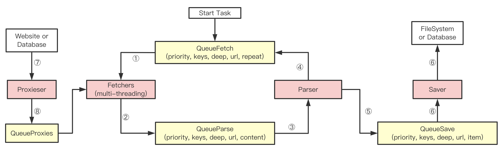

# PSpider

A simple web spider frame written by Python, which needs Python3.8+

### Features of PSpider

1. Support multi-threading crawling mode (using threading)
2. Support using proxies for crawling (using threading and queue)
3. Define some utility functions and classes, for example: UrlFilter, get_string_num, etc
4. Fewer lines of code, easyer to read, understand and expand

### Modules of PSpider

1. utilities module: define some utilities functions and classes for multi-threading spider
2. instances module: define classes of Fetcher, Parser, Saver for multi-threading spider
3. concurrent module: define WebSpiderFrame of multi-threading spider

### Procedure of PSpider

①: Fetchers get TaskFetch from QueueFetch, and make requests based on this task  
②: Put the result(TaskParse) of ① to QueueParse, and so Parser can get task from it  
③: Parser gets task from QueueParse, and parses content to get new TaskFetchs and TaskSave  
④: Put the new TaskFetchs to QueueFetch, and so Fetchers can get task from it again  
⑤: Put the TaskSave to QueueSave, and so Saver can get task from it  
⑥: Saver gets TaskSave from QueueSave, and saves items to filesystem or database  
⑦: Proxieser gets proxies from web or database, and puts proxies to QueueProxies  
⑧: Fetcher gets proxies from QueueProxies if needed, and makes requests based on this proxies

### Tutorials of PSpider

**Installation: you'd better use the first method**  
（1）Copy the "spider" directory to your project directory, and `import spider`  
（2）Install spider to your python system using `python3 setup.py install`

**See test.py**

### Batch outcome

`wait_for_finished()` returns a dict-like `BatchResult`. It still contains every
original counter keyed by `TPEnum` (so existing code keeps working), and adds:

| key | meaning |
| --- | --- |
| `outcome` | `completed`, `completed_with_failures`, `retry_exhausted`, `proxies_exhausted`, `retry_and_proxies_exhausted` or `incomplete` (see `BatchOutcome`) |
| `converged` | all work drained, without any retry/proxies exhaustion |
| `drained` | every queue was empty when the pool stopped |
| `success` | drained and no failure at all |
| `failures` | bounded list of `{"url", "stage", "reason", "reasons", "terminal", "repeat", ...}` |
| `failed_urls` | urls of the retained failures |
| `failure_reasons` / `retry_reasons` | reason -> count (`FailureReason`) |
| `failure_total` / `failure_event_total` / `retry_total` | terminal failures, all failure events, retries |
| `retry_exhausted_count` / `proxy_fail_count` | failures caused by max_repeat / unavailable proxies |

A task asking for repeat is put back to QueueFetch at most until `Fetcher.max_repeat`;
after that it is recorded as `retry_exhausted` and counted as a failure, so a url that
never succeeds can no longer loop forever. Proxy-failure attribution is per url:
`state_proxies=-1` adds `proxy_invalid`, `state_proxies=0` adds `proxy_returned`.
Failed details are capped by `max_failures` (default 100, `0` keeps none) while the
counters keep counting everything, so long running spiders stay bounded in memory.

See `tests/test_batch_outcome.py` for local, network-free examples based on a fake Fetcher.

### TodoList

1. More Demos
2. Distribute Spider
3. Execute JavaScript

### If you have any questions or advices, you can commit "Issues" or "Pull requests"
