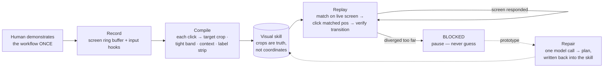

# REFLEX — a visual skill compiler for screen automation

[](https://github.com/MARCCHERGGI/reflex/actions/workflows/ci.yml)
[](LICENSE)
[](https://www.python.org/)
[](#run-it)


**Demonstrate a GUI workflow once. REFLEX compiles the recording into a visual state
machine and replays it faster than the demonstration — with zero LLM calls per action —
against a window that moved, rows that shuffled, and a theme that changed color.**

Computer-use agents re-pay a model call for every click, which makes them slow, expensive,
and nondeterministic on workflows a human could teach in fifteen seconds. RPA tools solved
replay decades ago but break on anything that moves. REFLEX sits between them:

- **Record**: a screen ring buffer (~12fps, `mss`) + global input hooks (`pynput`) capture
  a human demonstration as frames + actions.
- **Compile**: each click becomes a state — target crop, tight band, context crop, and a
  label strip, all cut from the frame the human aimed at. No coordinates are stored as
  truth; crops are the truth.
- **Replay**: each state matches its crops on the *live* screen (OpenCV template matching
  with a pyramid search), clicks at the *matched* position, and verifies the screen
  actually responded before advancing. Timeouts pause the run as BLOCKED — the runtime
  never guesses.
- **Repair** (prototype): a BLOCKED run builds a compact repair package and asks a model
  for ONE plan; a successful repair is written back into the skill as a new version, so
  the same exception never costs a second model call.

## Pipeline



## Benchmark

The benchmark app (`reflex/mock_app.py`, tkinter) randomizes **window position, row order,
accent color, and spinner duration** per launch and writes its own ground-truth log of what
was actually clicked and typed — replays are scored against reality, not against the
runtime's opinion of itself.

Each run: fresh demonstration → compile → relaunch randomized → replay from crops only.

### Mock app, 100 unattended runs

| outcome | count |
|---|---|
| PERFECT (all fields exact, correct shuffled row, DONE) | 100 |
| MISROUTE (text in a wrong field) | 0 |
| BLOCKED (honest refusal, nothing wrong typed) | 0 |
| CRASH/other | 0 |

Median replay: 6.5s (demonstration: 14.4s). LLM calls per replay: 0.

### Real Chrome tab (throwaway profile), 30 reps

Window position AND form field order randomized per replay; ground truth is the page itself confessing which fields received which text (document.title).

| outcome | count |
|---|---|
| DEMO-INVALID | 1 |
| PERFECT | 29 |

Valid reps (contention/demo-invalid excluded): 29.


## The matching rules were earned, not designed

Every rule in `matcher.py` exists because a measured failure demanded it:

| Rule | The failure that earned it |
|---|---|
| Change detection counts moved pixels, not mean diff | a menu opening changed 0.2% of the screen and mean-diff called it "no change" |
| Featureless crops are refused, not matched | a blank patch of one app matched a blank patch of a *different app* at confidence 1.0 and 33 characters went into the wrong window |
| Tight band beats square crop in lists | reordered rows dragged old neighbors into the crop → 0.81 confidence on the right row |
| Label strip through the cursor row, matched globally | three pixel-identical empty form fields are distinguishable only by the labels beside them; every cursor-local crop excluded the label and text landed in the wrong field |
| Twin margin: the best row must beat the runner-up by ≥0.02 | a strip win inside noise of a sibling row is a coin flip, not a localization |
| Edge-domain rescue (raw float Sobel magnitude) | a randomized accent color dropped grayscale correlation to 0.72–0.85 on the same button; gradient structure survives color |
| Focus clicks verify via the next type-state's visible text | a caret is 1px — invisible to change detection; the honest evidence that focus landed is that typing appears |

`reflex/matcher.py` journals every decision (context confidence, strip margin, fallbacks
taken, final box) to `diag_find.jsonl` — when a run misbehaves, the evidence chain is one
read away.

## Run it

Windows, Python 3.13+, `pip install mss pynput opencv-python numpy`.

```
python reflex/flow.py        # one full cycle: demo → compile → randomized replay → verdict
python reflex/bench100.py    # the unattended 100-run benchmark (waits for an idle desktop)
```

`kernel/motor.py` is the only component that emits input (SendInput, DPI-proof 0–65535
virtual-desktop space). It honors a `SAFE_STOP` file before every emission — drop the file
next to `journal/` and everything stops.

## Honest limitations

- The benchmark is a controlled mock app, not a production suite. It randomizes what real
  apps change (position, order, theme, timing) but it is one workflow on one machine.
- The repair path is a working prototype, not benchmarked yet.
- Windows-only (SendInput, virtual-desktop coordinates).
- Recording quality matters: crops are cut from the frame the human aimed at; a demo
  performed during heavy screen churn will compile weaker anchors.
